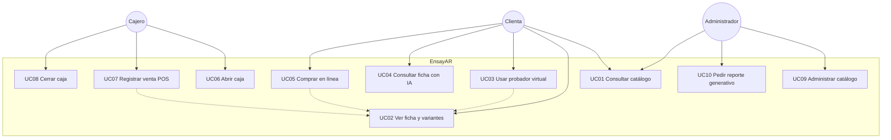
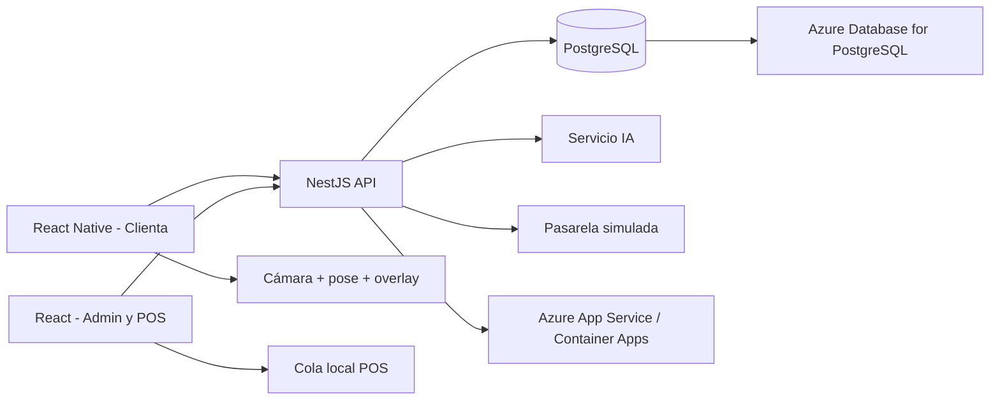

# Parte 2 — Proceso Unificado: Fase de Inicio

**Sistema:** EnsayAR  
**Hito:** Lifecycle Objective (objetivos del ciclo de vida acordados)  
**Fecha de la fase:** 12 de septiembre de 2026  
**Presentación del parcial:** 23 de septiembre de 2026  

Referencia: Jacobson, I., Booch, G. y Rumbaugh, J. *El Proceso Unificado de Desarrollo de Software*.

---

## 1. Propósito de esta fase

En Inicio se responde: ¿hay un problema real, un sistema viable y un alcance que se puede entregar el 23 de septiembre?

Esta fase **no** construye el producto. Produce la visión, los actores, los casos de uso a alto nivel, los riesgos y una arquitectura candidata. La Elaboración detallará los casos de uso críticos y fijará el baseline arquitectónico.

---

## 2. Visión

EnsayAR es una plataforma omnicanal para una cadena nacional de **moda femenina** (prendas, básicos, calzado, carteras, joyería; ocasiones social, casual y trabajo).

Hoy la marca crece abriendo sucursales. Eso no escala: la clienta tiene que ir al local, el horario corta las ventas, hay más personal y los envíos a ciudades sin tienda (p. ej. Camiri) se complican.

EnsayAR vende **24/7 en línea** y **en caja física (POS)** sobre el mismo inventario. Las dos capacidades que justifican el sistema frente a un e-commerce genérico son:

1. **Probador virtual** en el teléfono: la clienta ve la prenda sobre *su* cuerpo, no sobre un maniquí.
2. **Reportes generativos:** la administración pide información en voz o texto y el sistema arma la consulta en el momento (texto → SQL de solo lectura).

El nombre junta *ensayar* (probarse ropa) y *AR* (realidad aumentada).

---

## 3. Problema

| Pregunta | Respuesta |
|----------|-----------|
| ¿Quién lo padece? | La cadena (costos de expansión) y la clienta (tiene que ir a la tienda o compra a ciegas). |
| ¿Cuál es el problema? | El modelo presencial no atiende demanda 24/7 ni geografía; el e-commerce de ropa falla si no se puede ensayar. |
| ¿Cuál es el impacto? | Tiendas saturadas, más sucursales, más planilla, ventas perdidas de noche y en provincias; devoluciones si se vende sin prueba. |
| ¿Qué solución se propone? | EnsayAR: catálogo con variantes, POS, pagos básicos, probador 2D+pose, asistente de ficha e informes bajo demanda. |

Una polera no es un ítem plano: es un producto con **talla × color**, stock por sucursal/almacén y fotos por color. Sin ese modelo, el inventario miente.

---

## 4. Objetivos

### 4.1 General

Desarrollar y desplegar en Azure un MVP omnicanal (web + móvil + API) que permita consultar, ensayar de forma asistida y comprar ropa femenina, y que permita a la tienda vender en caja y consultar ventas en lenguaje natural, aplicando el Proceso Unificado y UML.

### 4.2 Específicos

1. Especificar requisitos funcionales y no funcionales del MVP del 23 de septiembre.
2. Modelar actores y casos de uso que dirigen el ciclo (catálogo, probador, checkout, POS, reporte generativo).
3. Diseñar inventario matricial (producto, variante, almacén).
4. Implementar backend NestJS, web React (admin/POS) y móvil React Native (clienta + cámara).
5. Integrar un probador por cámara + estimación de pose + overlay 2D de la variante.
6. Integrar reportes generativos acotados (voz/texto → SQL SELECT).
7. Desplegar en Microsoft Azure (no localhost).
8. Documentar el proceso con PUDS y dejar mecanismos de adopción para la clienta, el cajero y el admin.

---

## 5. Alcance del parcial

### 5.1 Entra (MVP)

- Autenticación y roles: clienta, cajero, administrador.
- Catálogo con filtros (categoría, ocasión, talla, color, precio).
- Variantes talla × color, fotos por color, stock por sucursal/almacén.
- Carrito y checkout: **contra entrega** y **QR simulado**.
- POS: apertura de caja con fondo, venta presencial, cierre/arqueo simple (un turno).
- Probador: cámara, pose del cuerpo, prenda 2D de la variante sobre el torso; fallback por foto de cuerpo completo.
- Asistente IA: preguntas sobre la ficha de la prenda visible.
- Reportes fijos básicos (ventas del día / sucursal) y **un** motor generativo acotado a ventas, sucursal, horario y cajero.
- Cola offline mínima del POS: registrar venta local y sincronizar al volver la red.
- Deploy Azure + PostgreSQL.

### 5.2 No entra

| Fuera | Motivo |
|-------|--------|
| Reservas para probar en vestidor físico | Enunciado de otro docente; no descalifica este parcial. |
| Pasarela real (Stripe, Libélula, tarjeta bancaria) | Entorno académico; se simula QR y se cobra en caja. |
| Probador 3D con deformación de tela | Inviable en 11 días; se declara como riesgo aceptado. |
| PWA completa / modo offline de todo el e-commerce | Solo cola del POS. |
| Precio mayorista / escalas por volumen | Complejidad de pricing; post-parcial. |
| Proveedores, temporadas y colecciones como módulo | Se puede etiquetar “temporada” en el producto, sin ERP de compras. |
| CMS e-commerce (Shopify, Magento, WooCommerce, PrestaShop) | Prohibido. |
| Flutter, Angular, FastAPI, Spring Boot | No son el stack de este parcial. |

---

## 6. Stakeholders y actores

| Actor | Tipo | Objetivo |
|-------|------|----------|
| Clienta | Primario | Ver, ensayar y comprar sin ir a la tienda, o comprar en tienda con el mismo stock. |
| Cajero | Primario | Abrir caja, cobrar en el local, cerrar el turno. |
| Administrador | Primario | Cargar catálogo, ver inventario, pedir reportes (también por voz). |
| Servicio de IA | de apoyo | Traducir pregunta de ficha o de reporte; no decide stock. |
| Pasarela simulada | de apoyo | Confirmar o rechazar un QR de prueba. |
| Sistema | interno | Descontar stock del almacén correcto. |

El encargado de sucursal y el proveedor (PDF Garzón) no son actores del MVP.

---

## 7. Modelo de casos de uso (Inicio)

En Inicio los casos de uso van **en formato breve**: nombre, actor, éxito. El texto expandido y las secuencias son de Elaboración.

### 7.1 Diagrama

### 7.2 Casos de uso breves

| ID | Caso de uso | Actor | Éxito |
|----|-------------|-------|--------|
| UC01 | Consultar catálogo | Clienta, Admin | Lista filtrada de prendas con precio y disponibilidad. |
| UC02 | Ver ficha y variantes | Clienta | Ve colores, tallas, fotos y stock de la sucursal elegida. |
| UC03 | Usar probador virtual | Clienta | Ve la variante superpuesta sobre su cuerpo (cámara o foto). |
| UC04 | Consultar ficha con IA | Clienta | Recibe respuesta sobre material, cuidado o combinación a partir de la ficha. |
| UC05 | Comprar en línea | Clienta | Pedido creado; pago contra entrega o QR simulado; stock descontado. |
| UC06 | Abrir caja | Cajero | Turno abierto con fondo inicial. |
| UC07 | Registrar venta POS | Cajero | Venta cobrada (efectivo/QR); stock descontado; ticket. |
| UC08 | Cerrar caja | Cajero | Arqueo: esperado vs declarado. |
| UC09 | Administrar catálogo | Administrador | Alta/edición de producto, variantes, fotos y stock por almacén. |
| UC10 | Pedir reporte generativo | Administrador | Pregunta en voz o texto → tabla de ventas (SQL SELECT acotado). |

**Casos de uso críticos para la arquitectura (dirigen Elaboración):** UC03, UC07, UC10. Son los que concentran riesgo técnico (cámara/pose, consistencia de stock, SQL generado).

---

## 8. Especificación complementaria (RNF)

| ID | Requisito | Criterio |
|----|-----------|----------|
| RNF01 | Seguridad | Contraseñas hasheadas; JWT; el motor SQL solo ejecuta SELECT sobre vistas/tablas permitidas. |
| RNF02 | Disponibilidad | API y web en Azure; el POS no se detiene si cae internet (cola local). |
| RNF03 | Usabilidad | Web responsive; móvil para clienta y cámara. |
| RNF04 | Rendimiento | Catálogo usable con cientos de variantes; el overlay del probador debe sentirse en tiempo real en un teléfono medio. |
| RNF05 | Escalabilidad | Nuevas sucursales = filas de almacén, no un redeploy. |
| RNF06 | Mantenibilidad | Módulos NestJS; apps web y móvil separadas. |
| RNF07 | Integración | API REST. IA y pagos simulados detrás de puertos. |
| RNF08 | Compatibilidad | Móvil = React Native (no Flutter). |
| RNF09 | Pagos académicos | QR y contra entrega en entorno de prueba; sin cobro real. |
| RNF10 | Legal / prohibiciones | Sin CMS e-commerce. Código propio. |

---

## 9. Glosario

| Término | Definición |
|---------|------------|
| EnsayAR | Nombre de la plataforma. |
| Variante | Combinación vendible talla × color de un producto; tiene su propio stock y fotos. |
| Almacén | Depósito de stock de una sucursal (o bodega). Toda venta descuenta de uno. |
| POS | Punto de venta físico: caja, turno, ticket. |
| Arqueo | Comparar el efectivo/QR del turno con lo que el sistema espera. |
| Probador 2D+pose | Cámara + puntos del cuerpo + imagen de la prenda encima; no simula tela 3D. |
| Reporte generativo | Informe no prediseñado, armado en el momento a partir de voz/texto. |
| SQL acotado | Solo SELECT; whitelist de tablas/columnas; límite de filas. |
| Cola offline | Ventas POS guardadas en el dispositivo hasta que hay red. |
| Omnicanal | Un inventario; dos canales (web/móvil y caja). |

---

## 10. Riesgos (Inicio)

| # | Riesgo | Impacto | Mitigación |
|---|--------|---------|------------|
| R1 | El probador 3D “de catálogo” no entra en 11 días | Alto | Alcance explícito: 2D+pose + fallback foto. Se documenta la limitación. |
| R2 | SQL generado escribe o lee de más | Alto | Whitelist, SELECT, usuario de BD de solo lectura, tope de filas. |
| R3 | Stock se descuenta dos veces (web + POS) | Alto | Transacción por variante+almacén; pruebas de UC05 y UC07. |
| R4 | Azure o cuenta estudiantil bloquea el deploy | Medio | Subir API + web en la primera semana de construcción, no el día 22. |
| R5 | Cámara/pose no corre en emulador | Medio | Probar en teléfono físico; fallback foto. |
| R6 | Alcance se hincha (reservas, mayorista, PWA) | Alto | Lista 5.2; cualquier extra queda post-parcial. |
| R7 | Sin rúbrica formal de defensa | Bajo | El audio ya fijó las dos innovaciones como lo evaluable. |

Hito de Inicio cumplido si R1, R2 y R6 quedan aceptados por el equipo (esta versión los acepta).

---

## 11. Arquitectura candidata

Stack obligatorio del parcial: NestJS + TypeScript, React, React Native, PostgreSQL, Azure.

Módulos previstos del API: `Auth`, `Catalogo`, `Inventario`, `Ventas`, `Caja`, `IaFicha`, `IaReportes`, `Pagos`.

El baseline se prueba en Elaboración con tres spikes: overlay de pose, venta que descuenta stock, texto → SELECT.

---

## 12. Criterio de éxito del 23 de septiembre

Se considera alcanzado el Lifecycle Objective (y el parcial, a nivel Inicio) si:

1. Hay visión, alcance y no-alcance escritos (este documento).
2. Los diez casos de uso breves cubren las dos innovaciones y el POS.
3. Los riesgos R1–R6 tienen dueño (el equipo) y mitigación.
4. La arquitectura candidata usa solo el stack del docente.

La Elaboración parte de UC03, UC07 y UC10.
