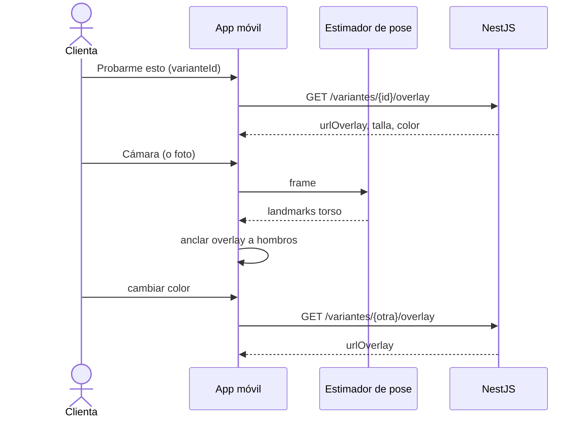
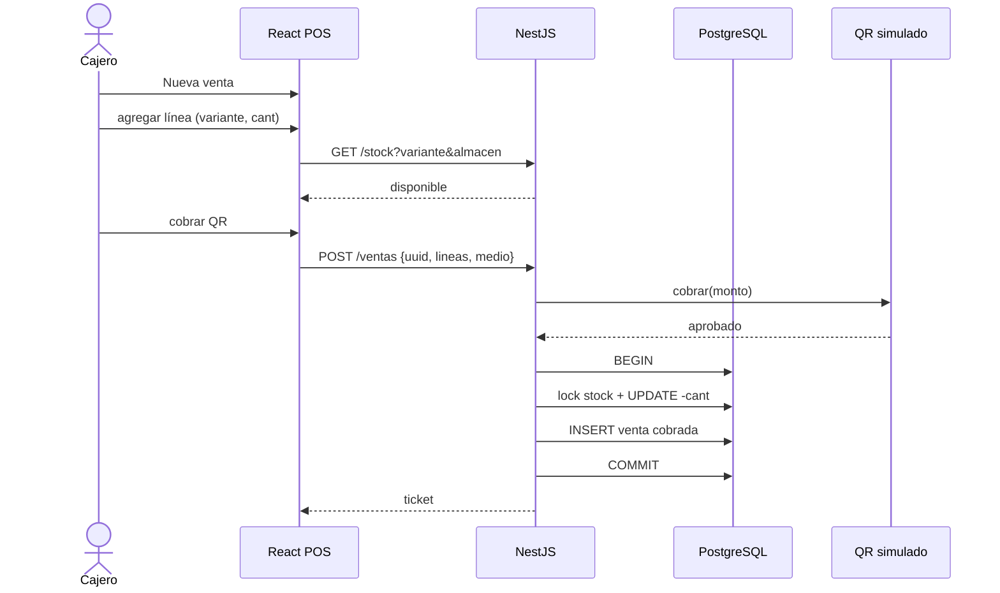
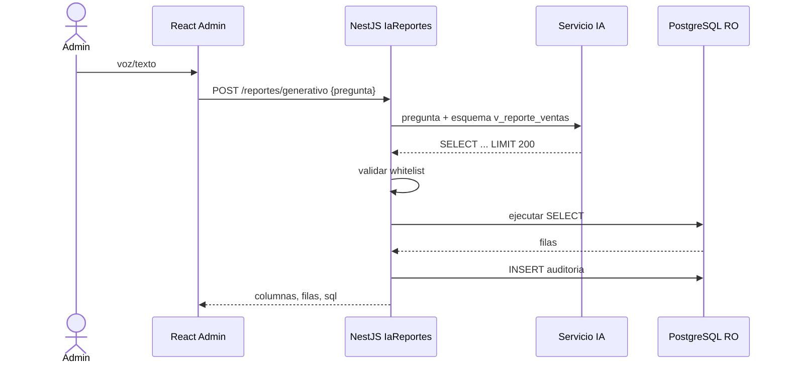
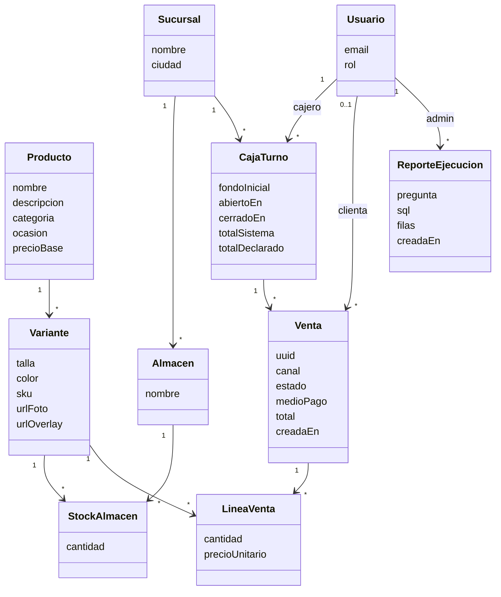
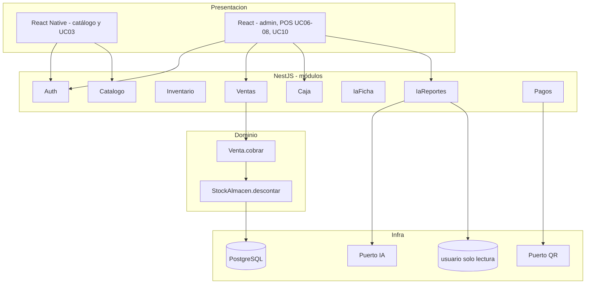

# Parte 2 — Proceso Unificado: Fase de Elaboración

**Sistema:** EnsayAR  
**Hito:** Lifecycle Architecture (baseline arquitectónico)  
**Fecha de la fase:** 12 de septiembre de 2026  
**Parte de:** casos de uso críticos UC03, UC07, UC10  

La Elaboración no implementa el producto entero. Estabiliza los requisitos que cargan riesgo y deja una arquitectura que Construcción puede llenar de funcionalidad.

---

## 1. Qué se elabora (y qué no)

| Se detalla ahora | Sigue en formato breve |
|------------------|------------------------|
| UC03 Probador virtual | UC01, UC02, UC04, UC05 |
| UC07 Venta POS | UC06, UC08, UC09 |
| UC10 Reporte generativo | |

UC05 (compra en línea) reutiliza el mismo contrato de descuento de stock que UC07. No se expande para no duplicar.

---

## 2. UC03 — Usar probador virtual (formato expandido)

| Campo | Contenido |
|-------|-----------|
| Actor principal | Clienta |
| Actores de apoyo | Ninguno (la pose corre en el dispositivo) |
| Precondiciones | Clienta autenticada. Tiene abierta una ficha (UC02) con una **variante** elegida (talla + color) que tiene imagen de overlay. |
| Postcondición de éxito | La clienta vio la variante sobre su cuerpo (cámara o foto). No se reserva ni se vende nada. |
| Trigger | Toca “Probarme esto”. |

### Flujo básico

1. El sistema muestra la variante elegida (nombre, talla, color, miniatura).
2. La clienta elige **cámara en vivo** (preferido) o **foto de cuerpo completo**.
3. El sistema pide permiso de cámara si hace falta.
4. Si es cámara: captura el video, estima la pose (hombros, cadera, torso) en el dispositivo.
5. Superpone la imagen 2D de la variante sobre el torso, escalada a la distancia entre hombros.
6. La clienta puede cambiar de color (otra variante del mismo producto y talla) sin salir del probador.
7. La clienta confirma “así me veo” o vuelve a la ficha. El caso termina.

### Alternativas

- **3a.** Niega el permiso → se ofrece solo el flujo por foto.
- **4a.** El dispositivo no estima pose (emulador, gama baja) → fallback foto: elige dos puntos (hombros) o un recuadro; el overlay se ancla ahí.
- **6a.** La nueva variante no tiene imagen de overlay → mensaje y se mantiene la anterior.

### Excepciones

- **E1.** No hay imagen de overlay en la variante → no se abre el probador; se pide al admin cargar overlay (UC09).
- **E2.** La cámara falla a mitad → se guarda el último frame y se pasa a modo foto.

### Reglas

- El overlay es **2D**. No se deforma tela ni se simula caída.
- No se envía el video al servidor. Solo se baja la imagen de la variante.
- El probador no toca stock.

### SSD (secuencia de sistema)

---

## 3. UC07 — Registrar venta POS (formato expandido)

| Campo | Contenido |
|-------|-----------|
| Actor principal | Cajero |
| Actores de apoyo | Pasarela simulada (si el medio es QR) |
| Precondiciones | Caja **abierta** (UC06). Cajero autenticado. El almacén de la sucursal del turno está definido. |
| Postcondición de éxito | Existe una `Venta` en estado `cobrada`; cada línea descontó stock de `StockAlmacen(variante, almacén)`; el turno acumula el total. |
| Trigger | Cajero inicia “Nueva venta”. |

### Flujo básico

1. El sistema crea un borrador de venta ligado al turno abierto y a su almacén.
2. El cajero agrega líneas: busca producto, elige variante (talla/color), indica cantidad.
3. Por cada línea el sistema verifica `stock >= cantidad` en ese almacén.
4. El cajero elige medio: **efectivo** o **QR simulado**.
5. Si efectivo: ingresa monto recibido; el sistema calcula vuelto.
6. Si QR: el sistema pide a la pasarela simulada un cobro de prueba; espera `aprobado`.
7. El sistema, en **una transacción**:
   - bloquea las filas de stock de las variantes;
   - descuenta cantidades;
   - persiste la venta `cobrada` y sus líneas;
   - suma el total al turno.
8. Emite ticket (pantalla + PDF/impresión simple).
9. El caso termina. La caja sigue abierta.

### Alternativas

- **2a.** Sin red: la venta queda en la **cola offline** del navegador con un `uuid` local. Al volver la red se envía a `/ventas` (idempotente por `uuid`). El stock se descuenta **en el servidor** al sincronizar, no dos veces.
- **4a.** La clienta cancela antes de cobrar → el borrador se descarta; stock intacto.
- **6a.** QR `rechazado` → se ofrece efectivo o se anula el borrador.

### Excepciones

- **E1.** En el paso 3, `stock < cantidad` → no se agrega la línea; se muestra stock real.
- **E2.** Entre el paso 3 y el 7 otra venta (web o POS) dejó stock insuficiente → rollback; se informa qué variante falló.
- **E3.** No hay turno abierto → se obliga UC06.

### Contrato de operación `cobrarVenta`

- **Pre:** turno abierto; borrador con ≥1 línea; cada línea `cantidad > 0`.
- **Post:** venta cobrada; ∀ línea, `stock' = stock - cantidad`; `turno.total' = turno.total + venta.total`.
- **No:** no crea clienta; no abre otra caja; no llama al probador.

### SSD

---

## 4. UC10 — Pedir reporte generativo (formato expandido)

| Campo | Contenido |
|-------|-----------|
| Actor principal | Administrador |
| Actores de apoyo | Servicio de IA |
| Precondiciones | Admin autenticado. Existen ventas (si no, el resultado es vacío, no error). |
| Postcondición de éxito | Se muestra una tabla (y opcionalmente un total) que responde la pregunta. Queda un `ReporteEjecucion` de auditoría (pregunta, SQL, filas, timestamp). **Nada se escribe** en ventas ni stock. |
| Trigger | Admin pulsa el micrófono o envía texto. |

### Flujo básico

1. El admin formula la pregunta (voz → texto, o texto directo). Ejemplo del docente: *ventas de la sucursal X, POS Y, de tal hora a tal hora; a quién y cuánto*.
2. El sistema envía al servicio de IA: la pregunta + el **esquema permitido** (no el esquema entero de la BD).
3. La IA devuelve un `SELECT` y un título.
4. El sistema **valida** el SQL:
   - una sola sentencia;
   - empieza por `SELECT`;
   - solo tablas/vistas de la whitelist (`v_reporte_ventas`);
   - sin `INSERT/UPDATE/DELETE/DROP/ALTER/COPY`;
   - `LIMIT` ≤ 200 (se inyecta si falta).
5. Ejecuta el SELECT con un usuario de BD de **solo lectura**.
6. Devuelve columnas + filas + el SQL (visible para defensa).
7. Persiste la auditoría y muestra el resultado.

### Alternativas

- **1a.** Voz no se entiende → se pide texto.
- **4a.** SQL inválido → se reintenta **una** vez con el error de validación; si falla, mensaje “no pude armar ese reporte” y se sugieren ejemplos.
- **5a.** Cero filas → tabla vacía, no es excepción.

### Excepciones

- **E1.** La pregunta pide algo fuera del dominio (empleados, contraseñas, otras BDs) → se rechaza antes de llamar a la IA.
- **E2.** El servicio de IA no responde → error controlado; no se inventa SQL en el cliente.

### Esquema permitido (`v_reporte_ventas`)

Columnas: `fecha_hora`, `sucursal_nombre`, `almacen_id`, `caja_turno_id`, `cajero_nombre`, `venta_id`, `cliente_nombre` (nullable), `variante_sku`, `producto_nombre`, `talla`, `color`, `cantidad`, `precio_unitario`, `subtotal`, `medio_pago`.

Preguntas legales: ventas por sucursal, por cajero, por rango horario, por prenda, totales. Nada más.

### SSD

---

## 5. Modelo de dominio

Clases conceptuales (no son tablas todavía; informan el diseño).

Reglas de dominio:

- Una `Variante` es talla × color de un `Producto`. El stock **nunca** vive en el producto.
- Toda `Venta` (web o POS) descuenta un `StockAlmacen`. El canal se guarda (`online` | `pos`).
- Un `CajaTurno` pertenece a una sucursal y a un cajero. UC07 exige turno abierto.
- `ReporteEjecucion` no referencia ventas por FK de negocio; es traza.

---

## 6. Modelo de datos lógico (baseline)

Tablas previstas (PostgreSQL):

`usuarios`, `sucursales`, `almacenes`, `productos`, `variantes`, `stock_almacen` (PK `variante_id + almacen_id`), `caja_turnos`, `ventas`, `lineas_venta`, `reporte_ejecuciones`.

Vista `v_reporte_ventas`: join de venta + línea + variante + producto + sucursal + turno + cajero. Es **lo único** que puede leer UC10.

Índices: `ventas(creada_en)`, `ventas(caja_turno_id)`, `stock_almacen(almacen_id)`, `variantes(producto_id)`.

---

## 7. Arquitectura baseline (4+1, vista lógica)

**Decisiones de diseño que ya no se discuten en Construcción:**

1. Un solo endpoint `POST /ventas` para UC05 y UC07 (`canal: online | pos`).
2. Descuento de stock solo en servidor, transaccional, con lock de fila.
3. Probador 100% en el cliente; API solo sirve `urlOverlay`.
4. Reportes generativos solo contra `v_reporte_ventas` y usuario RO.
5. Cola offline: `uuid` de venta + retry; el servidor es idempotente.

---

## 8. Spikes (pruebas de arquitectura)

Cada spike tiene que **correr** antes de llenar pantallas. Si falla, se ajusta el diseño aquí, no a ciegas en Construcción.

### Spike A — Overlay 2D + pose (R1, R5, UC03)

- App RN mínima: cámara + un PNG de polera.
- Estimar hombros (MediaPipe o equivalente en dispositivo).
- Escalar y anclar el PNG. Medir FPS en un teléfono real.
- **Pasa si:** 15+ FPS y el overlay sigue al torso; si no hay pose, el fallback foto funciona.
- **Falla si:** solo corre en emulador o pide servidor de video.

### Spike B — Venta que descuenta stock (R3, UC07)

- `POST /ventas` con dos requests paralelos de la misma última unidad.
- **Pasa si:** una venta `cobrada`, la otra 409/stock insuficiente; `stock` final = 0; el mismo `uuid` dos veces no duplica.
- **Falla si:** stock negativo o dos ventas cobradas.

### Spike C — Texto → SELECT acotado (R2, UC10)

- Pregunta del docente contra una `v_reporte_ventas` de prueba.
- Meter a propósito `DROP TABLE` y `SELECT * FROM usuarios`.
- **Pasa si:** la pregunta legal devuelve tabla; las maliciosas se rechazan sin ejecutar.
- **Falla si:** sale un SQL que toca otra tabla.

---

## 9. Criterio de éxito de Elaboración

El hito Lifecycle Architecture se cumple si:

1. UC03, UC07 y UC10 están en formato expandido (este documento).
2. El modelo de dominio distingue producto / variante / stock por almacén / venta / turno.
3. Las cinco decisiones de la §7 están escritas.
4. Los tres spikes tienen criterio pasa/falla. En Construcción se ejecutan primero.

Construcción implementa el resto de CU sobre este baseline, no rediseña el inventario ni el motor SQL.
