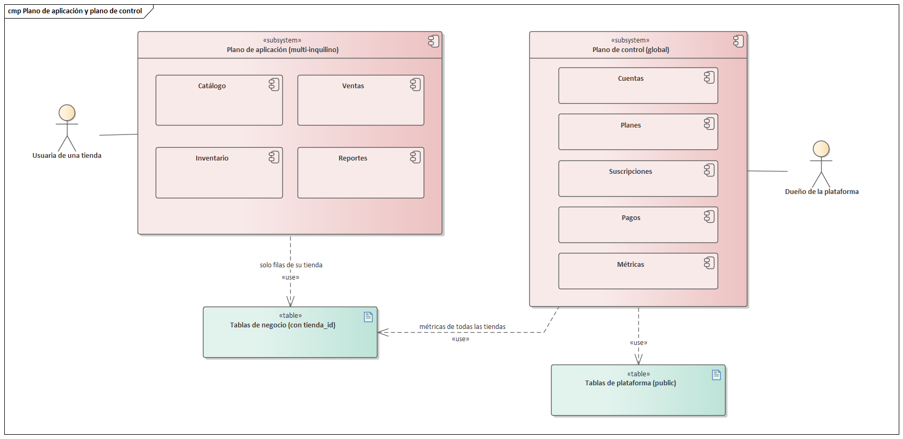
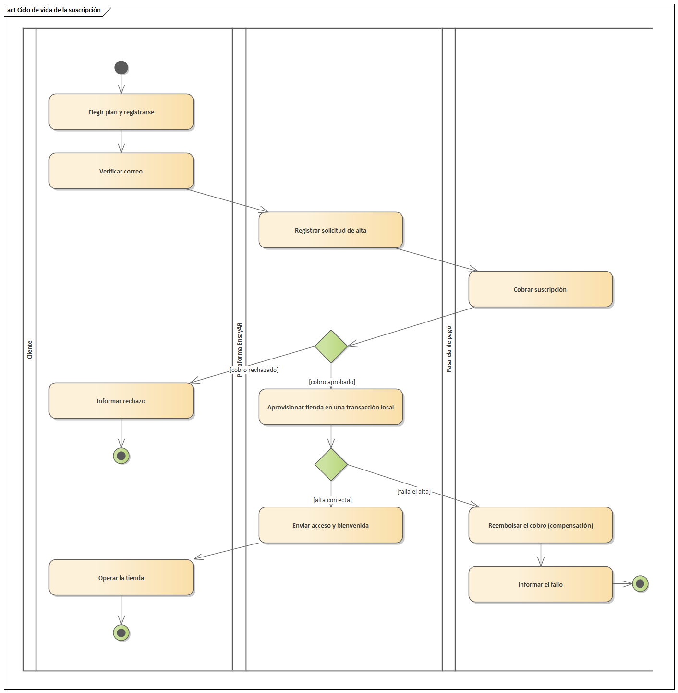

# 3. Desarrollo de software bajo el modelo SaaS

En el primer ciclo del proyecto, EnsayAR se concibió como el sistema de una sola tienda de moda femenina: catálogo en línea, punto de venta, inventario por sucursal, reportes generativos y probador virtual. El segundo ciclo cambia la naturaleza del producto. Ya no se entrega un sistema a una tienda, sino un servicio que muchas tiendas contratan, pagan periódicamente y usan sin instalar nada. El cambio no es solo comercial: obliga a revisar la identidad de los usuarios, el modelo de datos, el cobro, el aprovisionamiento y la operación. Este capítulo fundamenta el modelo Software como Servicio (SaaS), describe sus variantes y su lógica económica, y cierra con lo que efectivamente se implementa en EnsayAR y por qué.

## 3.1 Definición y características esenciales

La referencia más citada para definir la computación en la nube es la publicación especial 800-145 del NIST (Mell y Grance, 2011). Allí la nube se describe como un modelo que permite acceder por red, de forma ubicua y bajo demanda, a un conjunto compartido de recursos configurables que se aprovisionan y liberan rápidamente con un esfuerzo mínimo de gestión o de interacción con el proveedor. El modelo se compone de cinco características esenciales, tres modelos de servicio y cuatro modelos de despliegue.

SaaS es el modelo de servicio en el que el consumidor usa las aplicaciones del proveedor, que se ejecutan sobre una infraestructura en la nube, y accede a ellas desde distintos dispositivos mediante un navegador o una aplicación cliente. El consumidor no administra la red, los servidores, el sistema operativo, el almacenamiento ni las capacidades de la aplicación, salvo algunos parámetros de configuración propios de su cuenta. La frontera de responsabilidad queda desplazada casi por completo hacia el proveedor: el cliente gestiona sus datos y su configuración.

Las cinco características esenciales del NIST adquieren un significado concreto cuando el servicio es una aplicación de negocio:

- **Autoservicio bajo demanda:** el cliente obtiene el servicio sin intervención humana del proveedor; en SaaS, registrarse, elegir un plan, pagar y empezar a usar el sistema sin hablar con nadie.
- **Amplio acceso por red:** el servicio se consume desde navegador, teléfono o tableta mediante mecanismos estándar.
- **Agrupación de recursos:** los recursos del proveedor se comparten entre muchos consumidores bajo un modelo multi-inquilino y se asignan dinámicamente. Esta característica conecta directamente con el capítulo 4.
- **Elasticidad rápida:** la capacidad crece o se reduce con la demanda.
- **Servicio medido:** el uso se mide y se controla, lo que habilita cobrar por consumo, imponer límites y dar transparencia a ambas partes.

Los modelos de despliegue del NIST son nube privada, comunitaria, pública e híbrida. Un SaaS dirigido a pequeños comercios se ofrece normalmente sobre nube pública, porque su economía depende de compartir infraestructura entre muchos clientes pequeños. Para el cliente, la definición se resume en tres rasgos: no compra licencias ni infraestructura sino una suscripción; el proveedor opera, actualiza y respalda la aplicación; y el cliente puede cambiar de nivel a medida que su negocio cambia.

## 3.2 SaaS frente a otros modelos de entrega

**On-premise.** En el modelo tradicional, el cliente compra una licencia, normalmente perpetua, y ejecuta el software en sus equipos. Asume hardware, instalación, respaldos, seguridad y actualizaciones, y cada cliente puede quedarse en una versión distinta, lo que fragmenta el soporte. Ofrece control total y no depende de la conectividad, pero su costo de entrada es prohibitivo para una tienda pequeña.

**ASP (proveedor de servicios de aplicación).** En los años noventa, terceros comenzaron a alojar la aplicación del cliente en su centro de datos y a ofrecerla por red. Aunque el cliente no administra servidores, cada uno tiene su propia instancia, a menudo personalizada, de un software que no fue diseñado para compartirse. Chong y Carraro (2006) propusieron un modelo de madurez SaaS de cuatro niveles y ubicaron al ASP en el primero: instancias individuales y personalizadas. Los niveles siguientes agregan configurabilidad con un mismo código para todos, una sola instancia eficiente para muchos inquilinos y, por último, escalabilidad mediante una granja de instancias idénticas balanceadas.

**IaaS y PaaS.** Infraestructura como Servicio entrega procesamiento, almacenamiento y red, y el consumidor instala y controla el sistema operativo y sus aplicaciones. Plataforma como Servicio entrega un entorno de ejecución gestionado donde el consumidor despliega su propio código sin administrar servidores. SaaS está un nivel más arriba: el consumidor no despliega código, usa una aplicación terminada. Los modelos se apilan: un proveedor SaaS es a su vez cliente de PaaS o IaaS. EnsayAR es SaaS para las tiendas y cliente IaaS de AWS, donde una instancia EC2 aloja la API, la web y la base PostgreSQL.

| Capa | On-premise | ASP | IaaS | PaaS | SaaS |
|------|-----------|-----|------|------|------|
| Hardware e instalaciones | Cliente | Proveedor | Proveedor | Proveedor | Proveedor |
| Sistema operativo y red | Cliente | Proveedor | Cliente | Proveedor | Proveedor |
| Entorno de ejecución y base de datos | Cliente | Proveedor | Cliente | Proveedor | Proveedor |
| Aplicación | Cliente (licenciada) | Proveedor, una instancia por cliente | Cliente | Cliente | Proveedor, instancia compartida |
| Datos y configuración | Cliente | Cliente | Cliente | Cliente | Cliente |
| Pago típico | Licencia y mantenimiento | Cuota de alojamiento | Por recurso | Por recurso | Suscripción o uso |

## 3.3 Variantes del modelo SaaS

### 3.3.1 SaaS horizontal y vertical

Un SaaS horizontal resuelve una necesidad transversal a muchas industrias, como correo, ofimática o contabilidad genérica: su mercado es enorme, pero el producto tiende a ser genérico y la competencia es intensa. Un SaaS vertical se especializa en un sector y modela su vocabulario y sus procesos; su mercado es menor, pero el valor percibido es mayor. EnsayAR es un SaaS vertical para tiendas de moda: maneja variantes por talla y color, temporadas, colecciones, reservas para probarse en tienda, probador virtual y venta en caja que tolera cortes de internet. Ese ajuste al rubro justifica que una tienda pague por él en lugar de usar una herramienta genérica.

### 3.3.2 Single-tenant y multi-tenant

Un inquilino (tenant) es el cliente que contrata el servicio, con sus usuarios y sus datos. En un despliegue single-tenant cada cliente tiene su propia copia de la aplicación y de la base, aunque la opere el proveedor. En uno multi-tenant, una misma instancia atiende a todos y los datos se separan lógicamente. Entre ambos extremos hay combinaciones, como aplicación compartida con bases separadas o clientes grandes en infraestructura dedicada. El Azure Architecture Center subraya que la elección es también comercial: si se espera escalar a muchos clientes, compartir infraestructura es casi obligatorio porque mantener recursos por cliente se vuelve insostenible; si se esperan pocos clientes con exigencias fuertes de aislamiento, lo dedicado puede justificarse aunque cueste más. El capítulo 4 desarrolla este tema.

### 3.3.3 Marca blanca (white-label)

En la variante white-label, el cliente presenta el servicio con su propia identidad (logotipo, colores, dominio, a veces nombre comercial) sin que el usuario final perciba al proveedor. Es habitual en comercio electrónico, donde la tienda quiere que sus compradoras vean su marca. Exige dominios personalizados con certificados, plantillas configurables y correos enviados en nombre del cliente.

### 3.3.4 Plano de control y plano de aplicación

La guía SaaS Architecture Fundamentals de AWS divide toda solución SaaS en dos planos. El plano de control reúne los servicios para incorporar, autenticar, administrar, operar y analizar inquilinos: alta, identidad, registro de inquilinos, facturación, métricas y consola del proveedor. El plano de aplicación contiene la funcionalidad de negocio que usan los inquilinos. El documento aclara que los servicios del plano de control no son multi-inquilino: son globales y ven a todos los clientes, mientras que el plano de aplicación sí debe aplicar aislamiento. Esta separación ayuda a razonar qué operaciones pueden cruzar inquilinos y cuáles nunca deben hacerlo.



## 3.4 Modelos de cobro

La guía de modelos de precios del Azure Architecture Center parte de una idea simple: el precio debe cubrir el costo de servir a cada inquilino y dejar margen, y el modelo elegido condiciona lo que el sistema debe medir.

**Suscripción por período.** Es el modelo dominante en SaaS para pequeñas empresas: un monto fijo por un mes, tres meses o un año. Los períodos largos llevan descuento y benefician a ambas partes: el cliente paga menos por mes y el proveedor recibe caja por adelantado y reduce el abandono durante el período. El período mensual, en cambio, baja la barrera de entrada. La suscripción genera ingresos recurrentes y predecibles, base de las métricas de 3.6.

**Por usuario y por niveles.** En el cobro por usuario el precio crece con la cantidad de usuarios. Azure lo considera fácil de implementar, pero advierte que incentiva a compartir credenciales y puede ser poco rentable si unos usuarios consumen mucho más que otros; una variante cobra solo usuarios activos. El cobro por niveles ofrece paquetes con distinto alcance funcional, combinados con límites de uso (usuarios, sucursales, productos) y a veces con distintos acuerdos de servicio. Es claro comercialmente y ofrece un camino natural de crecimiento, pero obliga al sistema a saber qué corresponde a cada inquilino y a hacerlo cumplir en el servidor.

**Por uso.** El cliente paga lo que consume: transacciones, reportes, almacenamiento o llamadas a una API. La barrera de entrada es mínima y los ingresos crecen con los costos, pero exige medir con precisión el consumo de cada inquilino, produce ingresos menos predecibles y puede motivar al cliente a usar menos el producto.

**Freemium y prueba gratuita.** El freemium mantiene un nivel gratuito permanente con capacidades limitadas; la prueba gratuita da acceso temporal a un plan pago. Azure trata ambos como extensiones del cobro por niveles y advierte sus costos: operar inquilinos que no pagan, darlos de baja y definir políticas de retención. Skok señala que, si se usa prueba gratuita, la tasa de conversión es una de las primeras cifras a vigilar.

**Cumplimiento de límites.** Cualquiera sea el modelo, los límites solo existen si el servidor los hace cumplir. Ocultar un botón no basta, porque la API puede invocarse directamente; la verificación debe ocurrir donde se crea el recurso limitado, con una respuesta explícita que permita a la interfaz ofrecer el cambio de plan.

**Mercado hispanohablante.** La plataforma apunta a Bolivia y al resto de países de habla hispana. El medio de pago popular en un país (el QR interbancario en Bolivia) puede ser irrelevante en otro, y la pasarela elegida determina la comisión que termina pagando el cliente. Ese análisis corresponde al capítulo de formas de pago; desde la perspectiva SaaS interesa una propiedad transversal: el cobro debe ser **idempotente**, de modo que un doble clic o un reintento por red inestable no genere dos cobros ni dos tiendas.

## 3.5 Ciclo de vida del cliente

En un SaaS de autoservicio, cada etapa del ciclo de vida del inquilino debe completarse sin intervención del personal del proveedor.

1. **Descubrimiento:** una página comercial pública presenta el producto, los módulos, los planes, los precios y las preguntas frecuentes.
2. **Registro autoservicio:** el interesado crea una cuenta con su correo y una clave, sin formularios de contacto ni llamadas.
3. **Verificación del correo:** el sistema envía un enlace con un token aleatorio y de vida corta; hasta confirmarlo, la cuenta no opera. Así se prueba que el correo existe y pertenece a quien se registra, se frenan altas falsas y se asegura un canal para avisos de cobro y recuperación.
4. **Elección de plan y pago:** el cliente elige nivel y período, paga, y el sistema informa con claridad cualquier rechazo.
5. **Aprovisionamiento automático:** tras el pago, el sistema crea el espacio de trabajo con una configuración mínima utilizable y deja al cliente dentro. AWS describe este servicio de onboarding como el que orquesta la creación del inquilino, su administrador, sus políticas y sus recursos.
6. **Uso y expansión:** el cliente invita a su equipo y opera; al alcanzar un límite, se le ofrece subir de plan.
7. **Renovación o cambio de plan:** un cambio a un plan menor debe validar que el uso actual cabe en los nuevos límites.
8. **Vencimiento, baja y retención:** si no renueva, el servicio se suspende; conviene conservar los datos un plazo razonable para permitir la reactivación y luego eliminarlos o entregarlos según la política declarada.

Entre las etapas 4 y 5 hay un punto técnico delicado. El cobro ocurre en un sistema externo y el aprovisionamiento en la base propia, y no existe una transacción que abarque ambos. Si el cobro se aprueba y la creación del inquilino falla, el cliente pagó por nada. La solución habitual es tratar el proceso como una saga: se cobra, se aprovisiona en una transacción local y, si esta falla, se ejecuta una acción compensatoria que reembolsa el pago.



## 3.6 Métricas de negocio

Un negocio de suscripción no se gestiona con las métricas de una venta única. Skok, en SaaS Metrics 2.0, resume el éxito de un SaaS en tres palancas (adquirir, retener y monetizar clientes) y propone medir la economía unitaria comparando cuánto deja un cliente durante su vida con cuánto cuesta conseguirlo.

| Métrica | Definición | Cálculo habitual |
|---------|-----------|------------------|
| MRR | Ingreso recurrente mensual | Suma de suscripciones vigentes normalizadas a un mes; un plan anual aporta su monto entre 12 |
| ARR | Ingreso recurrente anual | MRR por 12 |
| ARPU o ARPA | Ingreso medio por cliente | MRR entre clientes vigentes |
| Churn de clientes | Proporción de clientes perdidos | Clientes perdidos en el período entre clientes al inicio |
| Churn de ingresos | Proporción del MRR perdido | MRR perdido por bajas y reducciones entre MRR al inicio |
| LTV | Valor de vida del cliente | Aproximación: ARPU por margen bruto, entre churn mensual |
| CAC | Costo de adquirir un cliente | Gasto de ventas y marketing entre clientes nuevos del período |
| LTV/CAC y recuperación | Rentabilidad de la adquisición | Cociente LTV/CAC; meses de ingreso para cubrir el CAC |

Skok reporta como referencia que los SaaS sanos superan un LTV/CAC de 3 y recuperan el CAC en menos de 12 meses, y advierte que el churn debe corregirse primero: si los clientes se van, invertir en adquisición equivale a llenar un balde agujereado. Las proyecciones combinan estas magnitudes; un modelo simple estima el MRR del mes siguiente como el actual por la fracción retenida (uno menos el churn) más los clientes nuevos esperados por el ARPU. Como toda proyección depende de sus supuestos, estos deben mostrarse junto al resultado.

## 3.7 Identidad cuando un usuario tiene varias tiendas

Es frecuente que una persona participe en varios inquilinos: una dueña con dos tiendas o una cajera que trabaja en dos locales. Hay dos enfoques.

El **login por tienda** da a cada inquilino su propia tabla de usuarios con correo y clave. Es simple y aísla por completo, pero multiplica las credenciales, duplica la autenticación, impide una vista de "mis tiendas" y complica la recuperación de cuenta.

La **cuenta global con membresías** mantiene una sola identidad por persona y una membresía por cada inquilino donde participa, con el rol que tiene allí. La guía de identidad multi-inquilino del Azure Architecture Center recomienda, cuando es posible, una sola identidad por persona, porque simplifica la administración y porque muchas protecciones de los proveedores de identidad se apoyan en esa unicidad. La misma guía describe el patrón: tras autenticarse, el usuario selecciona el inquilino activo y el sistema emite un token con el identificador de ese inquilino y el rol correspondiente; cambiar de inquilino exige un token nuevo.

| Criterio | Login por tienda | Cuenta global con membresías |
|----------|------------------|------------------------------|
| Credenciales por persona | Una por tienda | Una sola |
| Rol distinto por tienda | Natural | Se guarda en la membresía |
| Vista de todas mis tiendas | No es posible sin cruzar inquilinos | Directa |
| Cambio de tienda | Cerrar sesión y volver a entrar | Nuevo token sin pedir la clave |
| Verificación de correo | Repetida en cada tienda | Una sola vez |
| Riesgo principal | Claves débiles y repetidas | El token debe quedar atado a una sola tienda activa |

El riesgo del segundo enfoque se controla con una regla: el token de trabajo lleva una sola tienda activa, el servidor confía en esa tienda y no en lo que el cliente declare en otra parte de la petición, y cada cambio pasa por una verificación de membresía.

## 3.8 Ventajas, riesgos y responsabilidades del proveedor

Para el cliente, SaaS significa costo inicial bajo, pago proporcional a su tamaño, acceso desde cualquier lugar y actualizaciones sin esfuerzo. Para el proveedor, ingresos recurrentes, una sola versión que mantener y visibilidad sobre el uso real del producto. Los riesgos también son claros: el cliente depende de la conectividad y de la continuidad del proveedor, y puede quedar atado si no puede exportar sus datos; el proveedor concentra el riesgo, porque un despliegue defectuoso afecta a todos, una fuga entre inquilinos destruye la confianza y un inquilino que consume demasiado degrada a los demás (vecino ruidoso). De ello se derivan sus responsabilidades:

- **Disponibilidad:** objetivos de servicio realistas, monitoreo y diseño para fallos; en un punto de venta, la tolerancia a cortes de red del lado del cliente es parte de la disponibilidad percibida.
- **Seguridad y aislamiento:** ningún inquilino ve ni modifica datos de otro, las credenciales se protegen, el tráfico se cifra y el aislamiento se prueba de forma automatizada.
- **Actualizaciones:** cambios desplegados a todos sin interrupción, con migraciones de esquema controladas.
- **Respaldo y recuperación:** procedimientos de restauración, incluso cuando el incidente afecta a un solo inquilino.
- **Transparencia comercial:** precios claros, comprobantes, avisos de vencimiento y una política explícita sobre los datos de quien no renueva.

## 3.9 Aplicación en EnsayAR

Esta sección describe lo implementado en el repositorio y justifica cada decisión. Los nombres de modelos, rutas y archivos son los del código.

### 3.9.1 Posicionamiento y estructura

EnsayAR se define como un **SaaS vertical, multi-inquilino y de autoservicio** para tiendas de moda femenina de Bolivia y de países hispanohablantes. Es un monolito modular con NestJS 11, Prisma 6 y PostgreSQL, una web React 19 instalable como PWA y una app móvil Expo. Todas las tiendas comparten una instancia de la API y una base de datos, separadas por identificador de tienda (capítulo 4). En la escala de Chong y Carraro se ubica en el tercer nivel y queda preparado para el cuarto, porque la autenticación usa tokens JWT en lugar de sesiones en memoria y la tienda se resuelve en cada petición, de modo que la API puede replicarse detrás de un balanceador. La marca blanca es parcial: cada tienda tiene su vitrina con su nombre en la ruta /t/:slug, pero no hay dominios, logotipos ni colores propios.

La separación de planos de AWS se refleja en el backend. El módulo backend/src/plataforma es el plano de control: planes, registro y verificación de cuentas, suscripción, renovación y métricas, bajo el prefijo /plataforma, al que el middleware de inquilinos no asigna tienda. Los demás módulos (catálogo, ventas, caja, inventario, reservas, reportes, sincronización) son el plano de aplicación y operan siempre dentro de una tienda. En el esquema Prisma, el plano de control son los modelos Cuenta, Tienda, Plan, Suscripcion y PagoSuscripcion; los modelos de negocio llevan la columna tienda_id.

### 3.9.2 Planes y precios

La migración 20261108120000_saas_multitenant carga tres planes que combinan niveles funcionales con límites de uso, facturados en dólares estadounidenses como moneda neutral para un mercado regional; cada tienda conserva su moneda local para operar.

| Plan | Precio mensual | Usuarios de equipo | Sucursales | Productos | Módulos principales |
|------|---------------|-------------------|-----------|-----------|---------------------|
| Inicial | 19 USD | 3 | 1 | 200 | Catálogo, tienda en línea, punto de venta, inventario, reservas |
| Crecimiento | 49 USD | 10 | 3 | 2000 | Lo anterior más probador virtual, reportes con IA y asistente IA |
| Cadena | 129 USD | 50 | 20 | Sin límite | Lo anterior más analítica avanzada y precios mayoristas |

El enumerado PeriodoPlan define MENSUAL, TRIMESTRAL y ANUAL. El archivo backend/src/plataforma/precios.ts fija 1, 3 y 12 meses con descuentos de 0 %, 10 % y 20 %, y calcula el precio del período como precio mensual por meses por uno menos el descuento. El plan Inicial cuesta así 19 USD por mes, 51,30 por trimestre o 182,40 por año.

Se descartó el cobro por usuario puro porque incentivaría compartir la clave de caja, y el cobro por consumo porque la tienda pequeña valora un costo previsible; la cantidad de usuarios funciona como límite de cada nivel. No se implementa freemium ni prueba gratuita: la landing ofrece la tienda de demostración Vesta para explorar el producto sin registrarse, sin el costo de operar inquilinos que no pagan.

### 3.9.3 Recorrido de autoservicio

El recorrido se reparte entre frontend/src/plataforma y backend/src/plataforma/plataforma.controller.ts:

1. **Landing (/planes, Planes.tsx):** producto, selector de período con descuentos, planes con límites y módulos, pasos del alta y preguntas frecuentes. Consume GET /plataforma/planes.
2. **Registro (/empezar):** POST /plataforma/registro. Si el correo ya está verificado responde EMAIL_EN_USO; si existe sin verificar, reenvía el enlace.
3. **Verificación (/verificar):** POST /plataforma/verificar consume un token de 24 bytes aleatorios que vence a las 48 horas y devuelve una sesión de cuenta. Sin verificar, POST /plataforma/login responde EMAIL_NO_VERIFICADO y la pantalla ofrece reenviar.
4. **Asistente (/plataforma/nueva, NuevaTienda.tsx):** plan, datos de la tienda y pago. El slug se deriva del nombre y se consulta en GET /plataforma/slug-disponible; el país se elige de una lista hispanohablante con su moneda.
5. **Pago y alta:** POST /plataforma/suscribir cobra, crea la tienda y devuelve una sesión dentro de ella; la dueña entra a su panel sin un segundo login.
6. **Panel de la dueña (/plataforma, MisTiendas.tsx):** lista sus tiendas, permite entrar, ver la vitrina, revisar el uso frente a los límites, ver el historial de pagos y renovar o cambiar de plan.

El correo se envía por SMTP con nodemailer, compatible con Azure Communication Services. Sin credenciales SMTP, el servicio opera en modo simulado y la respuesta incluye el enlace para completar la demostración; la regla de negocio no cambia: sin verificación no hay ingreso ni suscripción.

### 3.9.4 Pago, idempotencia y compensación

El cobro se abstrae en la clase PasarelaSuscripcion (backend/src/plataforma/pasarela-suscripcion.ts), un puerto con las operaciones cobrar y reembolsar. Hoy se inyecta PasarelaSimulada, que valida el número con el algoritmo de Luhn y el formato del vencimiento y reproduce las tarjetas de prueba habituales: 4242 4242 4242 4242 se aprueba; las terminadas en 0002, 9995 y 0069 se rechazan por tarjeta rechazada, fondos insuficientes y tarjeta vencida. Pasar a una pasarela real en sandbox consiste en escribir otra implementación del puerto.

La idempotencia opera en dos niveles. El frontend genera una clave con crypto.randomUUID y la reutiliza en los reintentos del mismo intento, renovándola solo tras un rechazo. En el backend, idempotency_key es única en pagos_suscripcion; antes de cobrar, PlataformaService.suscribir busca esa clave y, si ya hay un pago aprobado, no cobra y devuelve la tienda creada marcada como repetida. El alta sigue además el patrón de saga: si el cobro se rechaza, se responde 402 PAGO_RECHAZADO y no se crea nada; si se aprueba, tienda, suscripción, pago y espacio inicial se crean en una sola transacción y, si esta falla, se reembolsa.

```
const cobro = await this.pasarela.cobrar(monto, plan.moneda, dto.pago, dto.idempotencyKey);
if (!cobro.aprobado) throw new HttpException({ codigo: 'PAGO_RECHAZADO' }, 402);
try {
  await TenantContext.enTienda(tiendaId, () =>
    this.prisma.$transaction(async (tx) => { /* tienda, suscripción, pago, aprovisionar */ }),
  );
} catch (error) {
  await this.pasarela.reembolsar(cobro.referencia).catch(() => undefined);
  throw error;
}
```

### 3.9.5 Aprovisionamiento automático y límites

El método aprovisionar crea, en la misma transacción, una sucursal "Casa matriz", un "Almacén principal", el perfil ADMIN de la cuenta que paga y seis categorías base. Todo corre dentro de TenantContext.enTienda con el identificador recién generado, de modo que la extensión de Prisma asigna la nueva tienda a cada registro sin que el código mencione tienda_id. El alta reutiliza el mismo mecanismo de aislamiento que el resto del sistema y no crea bases ni esquemas ni ejecuta migraciones: es instantánea. El slug se valida con una expresión regular y se rechaza si es una palabra reservada (www, api, admin, plataforma, planes, entre otras), previendo una futura resolución por subdominio.

El servicio PlanLimitesService (backend/src/tenancy/plan-limites.service.ts) calcula el uso de la tienda (usuarios de equipo activos, sucursales y productos) y lo compara con el plan vigente. Se invoca en el servidor antes de crear o reactivar usuarios de equipo, crear sucursales y crear productos, incluidos los que llegan por la sincronización offline y por el portal de proveedores. Al superar el límite responde 403 LIMITE_PLAN con el recurso, el máximo y el plan. Las clientas compradoras no cuentan, porque limitarlas contradiría el objetivo de la tienda.

### 3.9.6 Renovación, cambio de plan y vencimiento

POST /plataforma/tiendas/:id/renovar solo lo invoca la cuenta dueña (campo duenoCuentaId), con la misma idempotencia y compensación. Renovar el mismo plan extiende desde el vencimiento vigente, así que pagar antes no hace perder días. Cambiar de plan cancela la suscripción vigente y la nueva rige de inmediato con sus límites; antes de cobrar, el servidor verifica que el uso actual quepa en el plan destino o responde PLAN_INSUFICIENTE.

TiendasService considera vigente una tienda activa con una suscripción activa no vencida, y guarda el resultado en una caché de 30 segundos que se invalida al suscribir o renovar. Si una tienda no está vigente, toda petición de su espacio recibe 402 con SUSCRIPCION_VENCIDA, o TIENDA_SUSPENDIDA si su estado es suspendida. Los datos se conservan y la tienda vuelve a funcionar al renovar.

### 3.9.7 Identidad: una cuenta, varias tiendas

Se adopta la cuenta global con membresías. El modelo Cuenta guarda la identidad: correo único, hash bcrypt de la clave, correo verificado, token de verificación y el indicador esPlataforma del operador del SaaS. El modelo Usuario es el perfil de una cuenta dentro de una tienda (rol, sucursal, estado activo), con unicidad en (cuenta_id, tienda_id) y (tienda_id, email). La migración convierte a cada usuario existente en una cuenta con el mismo identificador y traslada la clave a cuentas, de modo que nadie pierde el acceso.

Hay dos tipos de token JWT (backend/src/auth/jwt-payload.ts): el de cuenta identifica a la persona y sirve al plano de control; el de tienda identifica el perfil, su rol, la tienda activa y la cuenta. CuentaAuthGuard acepta ambos, lo que permite consultar GET /auth/mis-tiendas e invocar POST /auth/cambiar-tienda desde dentro de una tienda; este verifica que la tienda destino esté vigente y que la cuenta tenga un perfil activo allí, y emite un nuevo token de tienda sin pedir la clave. JwtAuthGuard no confía solo en la firma: comprueba que el token no esté revocado, que la tienda siga vigente y que el perfil siga activo con el mismo rol y la misma cuenta.

En la interfaz, SelectorTienda (frontend/src/shared/SelectorTienda.tsx) muestra en la barra lateral las tiendas de la cuenta con el rol en cada una y las vencidas deshabilitadas. Al cambiar, la aplicación recarga porque los datos en memoria pertenecen a la tienda anterior, y fijarTienda (frontend/src/tienda.ts) descarta los datos locales de la tienda, como carrito, favoritos y catálogos offline. Si una cuenta intenta ingresar a una tienda donde no tiene perfil, el login responde SIN_ACCESO_TIENDA; si una clienta se registra en otra tienda con un correo existente, se reutiliza la cuenta cuando la clave coincide; si una administradora da de alta a un empleado ya registrado, se agrega la membresía sin cambiar su clave.

### 3.9.8 Métricas de la plataforma

GET /plataforma/admin/metricas está protegido por CuentaAuthGuard y PlataformaGuard, que exige esPlataforma; la página /plataforma/admin (Metricas.tsx) presenta los resultados. PlataformaService.metricas calcula:

- **MRR:** suma, sobre la suscripción vigente de cada tienda, del monto pagado entre los meses del período; **ARR** es MRR por 12 y **ARPU** es MRR entre tiendas vigentes.
- **Churn mensual:** tiendas cuya última suscripción venció en los últimos 30 días sin renovarse, entre esas bajas más las tiendas vigentes. Es churn de clientes, no de ingresos.
- **Series:** ingresos y altas de los últimos 12 meses, distribución por plan y período, y renovaciones de los próximos 30 días.
- **Proyección a 6 meses:** MRR del mes siguiente igual al actual por uno menos el churn, más las altas promedio de los últimos 3 meses por el ARPU; los ingresos esperados suman las renovaciones de cada mes, ponderadas por la probabilidad de seguir activas, más las altas estimadas. La respuesta incluye estos supuestos en texto.

LTV y CAC no se calculan: el LTV podría derivarse de los datos existentes, pero el CAC exige registrar el gasto de captación, que hoy no se registra. Se documentan como métricas conceptuales.

### 3.9.9 Verificación automatizada

El script backend/scripts/verificar-saas.ts (npm run verificar:saas) recorre el ciclo completo contra la API en ejecución con quince comprobaciones: planes y precios por período, bloqueo antes de verificar el correo, slug ocupado, tarjeta rechazada sin tienda creada, alta con sucursal, almacén y administradora, reintento idempotente sin doble cobro, aislamiento de catálogos, productos y reportes, acceso denegado a una tienda ajena, límites del plan Inicial, una cuenta en dos tiendas con cambio sin reingreso, vista de la dueña, elevación del límite al subir de plan, respuestas 402 y 404 para tiendas vencidas o inexistentes y acceso restringido a las métricas. Al terminar borra los datos de prueba.

### 3.9.10 Síntesis de decisiones

| Decisión | Alternativa descartada | Justificación |
|----------|------------------------|---------------|
| SaaS vertical para moda | Punto de venta genérico | El valor está en las reglas del rubro (variantes, reservas, probador) |
| Niveles con límites | Por usuario o por consumo | Precio previsible; no incentiva compartir claves |
| Períodos de 1, 3 y 12 meses con descuento | Solo mensual | Pedido del docente; mejora caja y retención |
| Tienda demo | Freemium | Evita operar inquilinos que no pagan |
| Pasarela detrás de un puerto | Llamada directa a la pasarela | Cambiar de simulada a real sin tocar el alta |
| Idempotencia por clave única | Confiar en que no se repita | Doble clic y red inestable son casos reales |
| Saga con reembolso | Transacción distribuida | No hay transacción entre pasarela y base |
| Cuenta global con membresías | Login por tienda | Un login, rol por tienda, cambio sin reingreso |
| Plano de control separado | Mezclar plataforma y negocio | Las operaciones globales quedan acotadas |

### 3.9.11 Limitaciones reconocidas

- La pasarela es simulada; la integración real corresponde al capítulo de formas de pago.
- Los módulos de cada plan se publican en la landing y en GET /tienda, pero el backend no bloquea un módulo no contratado; el cumplimiento se basa en los límites cuantitativos.
- No hay baja voluntaria ni borrado automático tras el vencimiento: la baja ocurre por no renovar y los datos se conservan. El script backend/scripts/lib/borrar-tienda.ts elimina una tienda completa, pero solo se usa en pruebas.
- El cambio de plan no prorratea los días no consumidos, y no existe una pantalla del operador para suspender tiendas aunque el estado suspendida se respete.
- Varias pantallas del frontend aún muestran montos con el símbolo Bs fijo, aunque la tienda tenga otra moneda.
