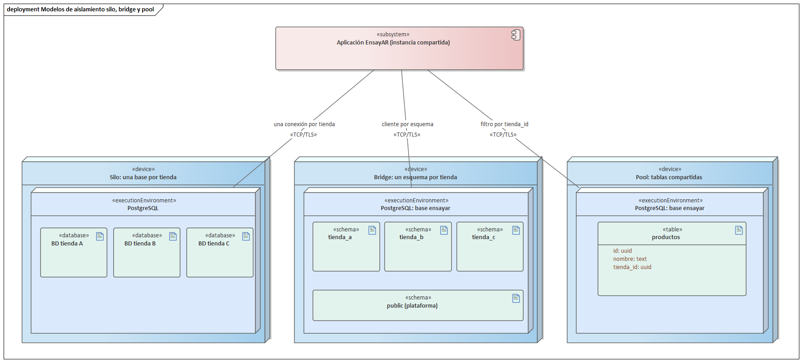
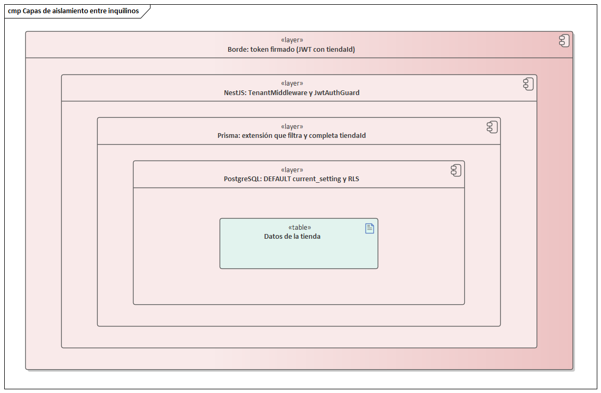
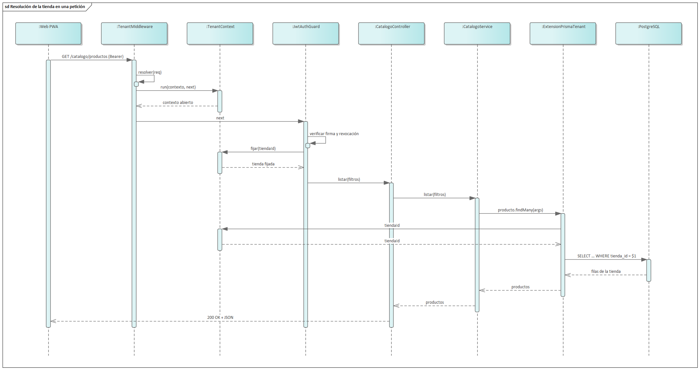

# 4. Organización de inquilinos (multi-tenant)

El capítulo anterior estableció que EnsayAR se ofrece como un servicio que muchas tiendas contratan. Este capítulo responde la pregunta técnica central de ese modelo: cómo una sola aplicación atiende a muchas tiendas sin que ninguna vea ni altere los datos de otra. Se define qué es un inquilino, se comparan los modelos de aislamiento, se explica cómo se identifica al inquilino en cada petición y cómo ese dato viaja por el código de un servidor Node.js, se describen las capas de defensa disponibles en NestJS, Prisma y PostgreSQL, y se cierra con la estrategia adoptada en EnsayAR y su justificación.

## 4.1 Qué es un inquilino

Un inquilino es la unidad de aislamiento de una solución SaaS: el cliente que contrata el servicio, junto con sus usuarios, su configuración y sus datos. La palabra viene de la analogía inmobiliaria: muchos inquilinos ocupan un mismo edificio, comparten estructura, agua y ascensores, pero cada uno tiene su departamento cerrado con llave.

La guía de modelos de inquilinato del Azure Architecture Center recomienda definir explícitamente qué es un inquilino antes de diseñar, porque no siempre coincide con un usuario. En soluciones de empresa a empresa, el inquilino suele ser una organización con muchos usuarios; en soluciones de empresa a consumidor, puede ser una persona o una familia. La misma guía distingue al inquilino lógico del despliegue físico donde residen sus datos, porque una solución puede crecer hasta tener varios despliegues y necesitar saber en cuál vive cada inquilino.

En EnsayAR, el inquilino es la **tienda**, representada por el modelo Tienda. Una tienda tiene sucursales, almacenes, productos, ventas, clientas y empleados. La persona no es el inquilino: una misma persona, representada por una Cuenta, puede pertenecer a varias tiendas con un perfil Usuario distinto en cada una. Separar persona e inquilino es lo que permite el login único descrito en el capítulo 3.

## 4.2 El aislamiento como espectro

El aislamiento no es una propiedad binaria. Azure lo describe como un espectro que va desde "no compartir nada" (cómputo, red, base de datos y dominio separados por inquilino) hasta "compartir todo", con posiciones intermedias donde, por ejemplo, se comparte la aplicación pero cada inquilino tiene su base. Además, el aislamiento tiene varias dimensiones que conviene separar:

- **Datos:** que un inquilino no pueda leer ni modificar registros de otro.
- **Rendimiento:** que la carga de un inquilino no degrade a los demás (vecino ruidoso).
- **Identidad:** que un usuario autenticado en un inquilino no pueda actuar en otro sin autorización.
- **Operación:** que un fallo, un despliegue o una restauración afecte al menor número posible de inquilinos.

Cada dimensión puede resolverse con un grado de aislamiento distinto. Un SaaS puede compartir el cómputo, aislar lógicamente los datos y aplicar límites de uso por inquilino para el rendimiento. Lo importante es que la elección sea consciente y esté justificada.

## 4.3 Modelos de aislamiento de datos

En la capa de datos se reconocen tres modelos clásicos.

### 4.3.1 Base de datos por inquilino

Cada inquilino tiene su propia base de datos y la aplicación elige la conexión según el inquilino de la petición. Es el aislamiento lógico más fuerte que se puede lograr sin duplicar la aplicación: un error de filtrado no puede exponer datos ajenos porque la conexión ni siquiera alcanza la otra base. Permite respaldar, restaurar, mover o borrar un inquilino de forma independiente, y aislar el rendimiento de los clientes más pesados. Sus costos son altos: cada base consume recursos aunque el inquilino esté inactivo, las migraciones de esquema deben aplicarse a cada base y coordinar sus versiones, el alta requiere crear y migrar una base, y los reportes globales del proveedor deben consultar muchas bases.

### 4.3.2 Esquema por inquilino

Todos los inquilinos comparten un servidor y una base, pero cada uno tiene su propio esquema con sus propias tablas. En PostgreSQL esto se apoya en el search_path de la sesión. El aislamiento es intermedio: las tablas están separadas, pero comparten servidor, memoria y conexiones. Es más barato que una base por inquilino, pero conserva el problema de las migraciones repetidas por esquema y el catálogo de la base crece con cada inquilino. Además, muchos ORM, entre ellos Prisma, están pensados para trabajar con un esquema conocido por conexión, lo que complica cambiar de esquema en cada petición.

### 4.3.3 Base compartida con identificador de inquilino

Todos los inquilinos comparten las mismas tablas y cada fila lleva una columna con el identificador del inquilino, típicamente llamada tenant_id. Es el modelo más eficiente: una sola base, una sola migración, alta instantánea porque solo se insertan filas, y reportes globales con una consulta. Su riesgo también es evidente: la separación depende de que **todas** las consultas filtren por esa columna. Un solo olvido produce una fuga de datos entre clientes. Restaurar a un solo inquilino es más difícil: Azure señala que, en una base compartida, suele requerir restaurar la base completa en otro recurso y recuperar selectivamente los datos de ese inquilino. Y el vecino ruidoso es más probable, porque todos comparten los mismos índices y la misma capacidad.

### 4.3.4 Terminología de AWS y Azure

El AWS Well-Architected SaaS Lens nombra tres modelos de aislamiento aplicables a cada capa o servicio:

- **Silo:** recursos dedicados por inquilino. AWS lo considera una variante válida de SaaS siempre que identidad, alta, métricas, despliegue y operación sigan siendo compartidos; intercambia economía de escala por cumplimiento normativo o por requisitos del dominio.
- **Pool:** recursos compartidos por todos los inquilinos, con almacenamiento indexado por identificador de inquilino. Aporta agilidad, eficiencia de costo y una operación unificada, pero AWS advierte que la dificultad de aislar no autoriza a relajar los requisitos de aislamiento, y menciona como desventajas el vecino ruidoso y la dificultad de atribuir costos por inquilino.
- **Bridge:** combinación de ambos según la capa. Por ejemplo, una capa web compartida y una capa de negocio y almacenamiento por inquilino.

Azure usa nombres equivalentes: despliegues automatizados de un solo inquilino, despliegues completamente multi-inquilino, despliegues particionados verticalmente (la mayoría de los inquilinos en infraestructura compartida y algunos en dedicada) y particionados horizontalmente (algunas capas compartidas y otras dedicadas, por ejemplo una aplicación común con bases por inquilino). Con esta terminología, la base por inquilino es un silo en la capa de datos, el esquema por inquilino es una forma de bridge dentro de un mismo servidor, y la base compartida con tenant_id es pool.

### 4.3.5 Comparación

| Criterio | Base por inquilino (silo) | Esquema por inquilino (bridge) | Base compartida con tenant_id (pool) |
|----------|---------------------------|--------------------------------|--------------------------------------|
| Aislamiento de datos | Fuerte: conexión distinta | Medio: tablas distintas, mismo servidor | Lógico: depende del filtrado y de RLS |
| Costo por inquilino | Alto, incluso inactivo | Medio | Muy bajo |
| Alta de un inquilino | Crear y migrar una base | Crear y migrar un esquema | Insertar filas, instantánea |
| Escalabilidad en cantidad de inquilinos | Limitada por la gestión de muchas bases | Limitada por el catálogo y las migraciones | Alta; escala con índices y particionado |
| Migraciones de esquema | Una por base, con riesgo de versiones mezcladas | Una por esquema | Una sola |
| Respaldo y restauración por inquilino | Directa | Posible por esquema | Compleja: restauración selectiva |
| Vecino ruidoso | Bien aislado en datos | Parcial | Mayor riesgo; requiere límites y monitoreo |
| Cumplimiento y residencia de datos | Más sencillo de demostrar | Intermedio | Requiere controles y auditoría adicionales |
| Reportes globales del proveedor | Consultas a muchas bases | Consultas a muchos esquemas | Una consulta |



## 4.4 Resolución del inquilino en cada petición

Antes de filtrar datos hay que saber a qué inquilino pertenece cada petición. La guía de mapeo de peticiones del Azure Architecture Center describe varios mecanismos:

- **Subdominio o dominio:** luna.ensayar.app identifica a la tienda Luna a partir de la cabecera Host. Es natural para el usuario y facilita la marca blanca, pero exige DNS comodín, certificados y una forma de elegir tienda desde una página de entrada común.
- **Ruta:** ensayar.app/t/luna. No requiere DNS y es fácil de compartir, pero todas las rutas de la aplicación deben llevar el prefijo.
- **Cabecera HTTP:** una cabecera propia, como X-Tienda. Azure advierte que no sirve para peticiones GET que el navegador emite por sí solo ni cuando un proxy puede eliminar cabeceras; es apropiada cuando el proveedor controla el cliente, como una SPA o una app móvil que llaman a una API.
- **Claims del token:** el token de acceso incluye el identificador del inquilino. Es el mecanismo más fuerte, porque el dato viene firmado por el servidor y no puede alterarse sin invalidar la firma.

La misma guía agrega dos advertencias. La primera: aunque la petición traiga un identificador de inquilino, la aplicación debe validar que el usuario esté autorizado para ese inquilino; el identificador no concede acceso por sí solo. La segunda: la resolución ocurre en cada petición, por lo que debe ser barata; si requiere consultar la base, conviene usar caché.

En la práctica se combinan mecanismos con un orden de precedencia: el token manda cuando hay sesión, y el subdominio, la ruta o la cabecera solo eligen tienda para las pantallas públicas sin sesión, como la vitrina o el login.

## 4.5 Propagación del contexto en Node.js

Una vez resuelto el inquilino, el dato debe llegar a todas las consultas que la petición ejecute, incluidas las que ocurren en servicios profundos que no reciben el objeto de la petición. En lenguajes con un hilo por petición se usa almacenamiento local de hilo. Node.js atiende miles de peticiones concurrentes en un solo hilo con un bucle de eventos: mientras una petición espera a la base, otra avanza. Una variable global no sirve, porque la tienda de una petición sería sobrescrita por la siguiente.

Hay tres alternativas. La primera es pasar el identificador como parámetro a cada función, lo que es explícito pero contamina todas las firmas y es fácil de olvidar. La segunda, propia de NestJS, son los proveedores con alcance de petición: el contenedor crea una instancia por petición con acceso al objeto Request, pero ese alcance se propaga a todos los proveedores que dependen de él y multiplica las instancias creadas. La tercera es **AsyncLocalStorage**, del módulo async_hooks de Node.js, marcado como estable en la documentación oficial. Su método run(store, callback) ejecuta el callback con un almacén asociado, y getStore() devuelve ese almacén desde cualquier operación asíncrona iniciada dentro del callback, sin importar cuántas llamadas o await haya en medio. Cada petición obtiene así su propio contexto, aislado del de las demás.

```
const als = new AsyncLocalStorage<TenantStore>();

export const TenantContext = {
  run<T>(store: TenantStore, fn: () => T) { return als.run(store, fn); },
  tiendaId() { return als.getStore()?.tiendaId; },
  enTienda<T>(tiendaId: string, fn: () => T | PromiseLike<T>) {
    return als.run({ tiendaId }, async () => await fn());
  },
  sinFiltro<T>(fn: () => T | PromiseLike<T>) {
    return als.run({ sinFiltro: true }, async () => await fn());
  },
};
```

El fragmento resume backend/src/tenancy/tenant-context.ts. Los métodos enTienda y sinFiltro abren contextos explícitos para el código que no nace de una petición HTTP, como el alta de una tienda, la semilla de datos o las métricas del proveedor. Ambos esperan el resultado dentro del contexto, porque las consultas de Prisma son perezosas y se ejecutan al ser esperadas.

## 4.6 Capas de defensa

En el modelo pool, una omisión de filtro es una fuga. Por eso se aplica defensa en profundidad: varias capas independientes, de modo que el fallo de una no exponga datos.

### 4.6.1 Filtro centralizado en la aplicación

La primera capa es que ningún desarrollador tenga que recordar el filtro. AWS, en su documento sobre estrategias de aislamiento de inquilinos, recomienda ocultar los detalles del aislamiento en bibliotecas compartidas, porque el modelo pool depende de que los desarrolladores sigan la convención y una convención manual termina fallando. En Prisma esto se logra con una extensión de cliente del tipo query: la documentación de Prisma muestra que $allModels y $allOperations permiten interceptar todas las operaciones de todos los modelos y modificar sus argumentos antes de ejecutarlas. La extensión agrega el filtro por inquilino a lecturas, actualizaciones y borrados, y asigna el inquilino a las altas. El principio clave es **fallar cerrado**: si no hay inquilino en el contexto, la consulta se rechaza en lugar de ejecutarse sin filtro.

### 4.6.2 Valores por defecto y restricciones en la base

La segunda capa traslada parte de la regla a PostgreSQL. La columna del inquilino puede declararse con un valor por defecto tomado de una variable de configuración de la sesión, de modo que una inserción que omita la columna reciba el inquilino fijado en la transacción. La función current_setting(nombre) lanza un error si la variable no existe, salvo que se le pase missing_ok en verdadero, en cuyo caso devuelve NULL. Usada sin missing_ok en un valor por defecto, convierte la ausencia de contexto en un error de inserción en vez de una fila huérfana. Las restricciones de unicidad deben, además, incluir la columna del inquilino: un SKU o el nombre de una categoría deben ser únicos dentro de cada tienda, no en toda la plataforma.

### 4.6.3 Row-Level Security de PostgreSQL

La tercera capa es la seguridad a nivel de fila. Según la documentación de PostgreSQL, al habilitar RLS en una tabla todo acceso normal debe estar permitido por una política; si no hay ninguna, se aplica una denegación por defecto. Cada política define una expresión booleana con USING para las filas visibles y WITH CHECK para las filas que se insertan o modifican.

```
ALTER TABLE productos ENABLE ROW LEVEL SECURITY;
ALTER TABLE productos FORCE ROW LEVEL SECURITY;
CREATE POLICY aislamiento_tienda ON productos
  USING (tienda_id = current_setting('app.tienda_id', true))
  WITH CHECK (tienda_id = current_setting('app.tienda_id', true));
```

La documentación advierte detalles que deben tenerse en cuenta. Los superusuarios y los roles con atributo BYPASSRLS siempre omiten las políticas, y el dueño de la tabla también, salvo que se use FORCE ROW LEVEL SECURITY. Las verificaciones de integridad referencial, como claves únicas y foráneas, no pasan por RLS y pueden filtrar información por canales encubiertos. Por eso la aplicación debe conectarse con un rol sin BYPASSRLS, y las migraciones y las tareas de plataforma con otro rol o con una política de excepción explícita.

El punto delicado con un ORM es el pool de conexiones: cada consulta puede usar una conexión distinta. El ejemplo oficial de Prisma para RLS resuelve esto fijando la variable con set_config en modo local y ejecutando la consulta en la misma transacción por lotes, de modo que comparten conexión y la variable desaparece al terminar. El propio ejemplo aclara que no está pensado para producción y que las transacciones explícitas pueden no comportarse como se espera. Azure, por su parte, señala que muchas soluciones multi-inquilino no usan RLS por la complejidad de diseñarla, probarla y mantenerla. RLS es la defensa más fuerte del modelo pool, pero su costo de adopción es real.



## 4.7 Resolución paso a paso en NestJS con Prisma

La pregunta "cómo se resuelve multi-tenant en una aplicación con Nest" tiene una respuesta en cinco pasos. Se ilustra con el código real de EnsayAR.

**Paso 1. Abrir el contexto en un middleware global.** NestJS permite registrar middleware de clase con inyección de dependencias en el método configure del módulo raíz; con forRoutes('*') se aplica a todas las rutas. El middleware abre el contexto de AsyncLocalStorage y ejecuta todo el resto de la petición dentro de él. Según la documentación de Nest, un error pasado a next llega a la capa de excepciones, que responde el código HTTP correspondiente.

```
use(req: Request, _res: Response, next: NextFunction) {
  const store: TenantStore = {};
  TenantContext.run(store, () => {
    this.resolver(req, store).then(() => next(), next);
  });
}
```

**Paso 2. Resolver la tienda.** El método resolver de backend/src/tenancy/tenant.middleware.ts aplica la precedencia de 4.4. Si la ruta empieza con /plataforma, no asigna tienda, porque es el plano de control. Si hay un token de tienda válido, manda la tienda del token, y la cabecera no puede cambiarla. Si no hay token, usa la cabecera X-Tienda con el slug y, en su defecto, la tienda configurada en TIENDA_POR_DEFECTO. Una cabecera con un slug inexistente produce 404 TIENDA_NO_EXISTE; una tienda sin suscripción vigente produce 402. La búsqueda pasa por TiendasService, con una caché de 30 segundos para no consultar la base en cada petición.

**Paso 3. Confirmar la tienda en el guard de autenticación.** JwtAuthGuard verifica la firma y la revocación del token, exige que sea de tipo tienda, comprueba que la tienda siga vigente y fija la tienda en el contexto con TenantContext.fijar. Luego consulta el perfil Usuario, ya filtrado por esa tienda, y exige que siga activo con el mismo rol y la misma cuenta que dice el token. Así, aunque alguien conserve un token viejo, un cambio de rol o una baja surten efecto de inmediato.

**Paso 4. Aplicar la tienda en todas las consultas.** El proveedor PrismaService no es un PrismaClient directo, sino el cliente extendido por crearPrismaTenant (backend/src/prisma/prisma.module.ts). La extensión de backend/src/tenancy/prisma-tenant.extension.ts calcula, a partir del metamodelo de Prisma, el conjunto de modelos con campo tiendaId que no son de plataforma, y en cada operación hace lo siguiente:

- Si el contexto es sinFiltro, ejecuta la consulta tal cual; solo lo usa el código de plataforma.
- Si el modelo debe filtrarse y no hay tienda en el contexto, lanza TENANT_REQUERIDO: falla cerrada.
- En lecturas, conteos, agregaciones y borrados, agrega tiendaId al where, incluso en findUnique, que en Prisma 6 admite campos no únicos adicionales en el filtro.
- En altas, inyecta tiendaId en los datos y lo propaga a las altas anidadas, como las variantes creadas junto con un producto.
- En actualizaciones y upsert, agrega el filtro y elimina tiendaId de los datos, para que ningún registro pueda "mudarse" a otra tienda.

```
const filtra = MODELOS_CON_TIENDA.has(model);
const tiendaId = store?.tiendaId;
if (!tiendaId) {
  if (filtra) throw new Error(`TENANT_REQUERIDO: ${model}.${operation}`);
  return query(args);
}
if (LECTURAS_Y_BORRADOS.has(operation) && filtra) a.where = { ...a.where, tiendaId };
else if (operation === 'create') a.data = conCreate(model, a.data, tiendaId);
// createMany, update, updateMany y upsert siguen la misma idea
```

**Paso 5. Validar identificadores que llegan del cliente.** Las claves foráneas no conocen de tiendas: un identificador válido de una variante de otra tienda pasaría la restricción referencial. Por eso, antes de escribir con identificadores recibidos, la función exigirDeLaTienda (backend/src/tenancy/pertenencia.ts) cuenta el registro a través del cliente extendido; como la consulta ya está filtrada, un identificador ajeno da cero y se responde 404 REFERENCIA_NO_EXISTE.

Con estos cinco pasos, los servicios de negocio escriben consultas como si la aplicación tuviera una sola tienda; la tienda se resuelve una vez en el borde y se aplica de forma transversal.



## 4.8 SQL crudo con set_config

Las extensiones de consulta de Prisma interceptan las operaciones de los modelos, pero el SQL crudo (queryRaw y executeRaw) no tiene un modelo al que agregar el filtro. Para estos casos se usan dos técnicas.

La primera es filtrar explícitamente: las actualizaciones de stock en ventas y de saldo en créditos incluyen la condición tienda_id igual a la tienda del contexto dentro del propio UPDATE, que además verifica atómicamente la cantidad disponible.

La segunda es fijar la tienda en la sesión de PostgreSQL. Según la documentación oficial, set_config(nombre, valor, is_local) con is_local en verdadero aplica el valor solo durante la transacción actual. Los reportes ejecutan, en una misma transacción por lotes de Prisma, el set_config y luego la consulta:

```
const tiendaId = TenantContext.tiendaIdOrThrow();
const [, filas] = await this.prisma.$transaction([
  this.prisma.$queryRaw`SELECT set_config('app.tienda_id', ${tiendaId}, true)`,
  this.prisma.$queryRawUnsafe<T[]>(sql),
]);
```

Del lado de la base, la vista v_reporte_ventas, creada en la migración 20261108120000_saas_multitenant, filtra con tienda_id igual a current_setting('app.tienda_id', true). Sin tienda fijada, current_setting devuelve NULL, la comparación nunca es verdadera y la vista no devuelve filas: también falla cerrada. El reporte generativo no ejecuta SQL libre: traduce una especificación validada a SQL parametrizado, y cada una de sus fuentes (backend/src/reportes/inteligente/catalogo.ts) incorpora la misma condición sobre current_setting como filtro base. En el módulo de reportes donde una consulta puede llegar como texto SQL, el validador backend/src/reportes/sql-seguro.ts exige una sola sentencia SELECT, prohíbe palabras como set_config, current_setting, set o reset y cualquier referencia a tablas reales, y solo admite la vista ya filtrada. Sin esa validación, una instrucción maliciosa podría fijar otra tienda antes de consultar.

## 4.9 Pruebas de aislamiento

Azure recomienda probar explícitamente que los datos de un inquilino no se filtran a otro, sea cual sea el modelo elegido. Las pruebas de aislamiento tienen dos niveles.

En el nivel de unidad de persistencia se ejercita la extensión directamente contra la base. El script backend/scripts/verificar-tenancy.ts (npm run verificar:tenancy) comprueba que al menos 30 modelos llevan tienda_id, que una tienda vacía ve cero productos, que sin tienda en el contexto la consulta falla con TENANT_REQUERIDO, que las altas anidadas heredan la tienda, que un producto de otra tienda es invisible aunque se conozca su identificador, que updateMany desde otra tienda afecta cero filas, que no se puede "mudar" un registro cambiando su tiendaId y que la vista de reportes no ve filas de otra tienda.

En el nivel de API, backend/scripts/verificar-saas.ts crea dos tiendas reales por el flujo de suscripción y verifica por HTTP que los catálogos y reportes de una no muestran datos de la otra, que con sesión de una tienda la cabecera X-Tienda de otra no cambia nada, que un producto ajeno pedido por identificador responde 404, que la administradora de una tienda no puede iniciar sesión en otra y que una tienda vencida responde 402. Estas pruebas reproducen el escenario que el docente anunció para la defensa: crear varias tiendas y verificar que cada una mantiene su espacio.

Una buena práctica adicional es incorporar estas pruebas a la integración continua, de modo que cualquier modelo nuevo sin tienda_id o cualquier consulta cruda sin filtro rompa la construcción antes de llegar a producción.

## 4.10 Evolución de la estrategia

El modelo pool no es un destino final sino un punto de partida que puede evolucionar con el negocio.

**RLS completa.** El siguiente paso de endurecimiento es habilitar y forzar RLS con una política por cada tabla de negocio, conectar la aplicación con un rol sin BYPASSRLS y ejecutar cada operación con la tienda fijada mediante set_config local. Con ello, incluso una consulta cruda sin filtro o un error futuro en la extensión quedarían contenidos por la base. El costo es envolver las operaciones en transacciones, prever un rol o una política de excepción para el plano de control y las migraciones, y revisar las transacciones interactivas existentes.

**Mover un inquilino grande a su propia base.** Si una cadena crece hasta convertirse en vecino ruidoso o exige aislamiento contractual, puede pasar a un despliegue particionado verticalmente: su propia base, con la misma aplicación. Se necesita un catálogo de inquilinos que guarde la ubicación de cada uno y que la resolución de 4.4 elija la conexión. Como cada fila ya lleva tienda_id, extraer los datos de un inquilino es una exportación filtrada por esa columna. Esta evolución puede venderse como un plan dedicado de mayor precio, tal como sugiere Azure.

**Sharding.** Con muchos miles de tiendas, una sola base deja de alcanzar. El patrón de sharding distribuye los inquilinos entre varias bases, cada una con uno o más inquilinos, mediante un mapa de shards. Azure distingue este patrón de los deployment stamps: los shards dividen solo la capa de datos sin duplicar el resto de la infraestructura. La columna tienda_id es la clave natural de distribución, y existen extensiones de PostgreSQL que distribuyen tablas por una columna de este tipo.

**Vecino ruidoso.** En paralelo, conviene limitar la tasa de peticiones por tienda, medir el consumo por inquilino y aplicar los patrones de limitación que Azure recomienda para bases compartidas.

## 4.11 Estrategia elegida en EnsayAR y justificación

### 4.11.1 Decisión

EnsayAR adopta el modelo **pool: base PostgreSQL compartida con columna tienda_id**, protegido por defensa en profundidad. Las tablas de plataforma (cuentas, tiendas, planes, suscripciones, pagos_suscripcion y tokens_revocados) no se filtran por tienda; suscripciones guarda tienda_id solo como clave foránea hacia la tienda que paga, porque pertenece al plano de control. Las 39 tablas de negocio del esquema actual sí la llevan: las 36 que convierte la migración 20261108120000_saas_multitenant y tres agregadas en migraciones posteriores (cuentas por cobrar, abonos de crédito y suscripciones de notificaciones push). Esa migración asigna los datos existentes a la tienda Vesta, crea índices por tienda_id y reemplaza las unicidades globales por unicidades por tienda, por ejemplo (tienda_id, sku) en variantes, (tienda_id, codigo) en cupones y (tienda_id, email) en usuarios. La migración 20261108130000_tienda_desde_sesion fija el valor por defecto de tienda_id en current_setting('app.tienda_id') para todas esas tablas.

### 4.11.2 Las capas en EnsayAR

| Capa | Mecanismo | Archivo o recurso |
|------|-----------|-------------------|
| Resolución | Token de tienda, cabecera X-Tienda o tienda por defecto; 402 y 404 | backend/src/tenancy/tenant.middleware.ts |
| Contexto | AsyncLocalStorage con enTienda y sinFiltro | backend/src/tenancy/tenant-context.ts |
| Autenticación | Guard que fija la tienda del token y revalida el perfil | backend/src/auth/jwt-auth.guard.ts |
| Filtro de aplicación | Extensión de Prisma que filtra, inyecta y falla cerrada | backend/src/tenancy/prisma-tenant.extension.ts |
| Pertenencia | Validación de identificadores recibidos | backend/src/tenancy/pertenencia.ts |
| Base de datos | DEFAULT desde current_setting y unicidades por tienda | migraciones 20261108120000 y 20261108130000 |
| SQL crudo | set_config local, vista filtrada y validador de SQL | reportes.service.ts, v_reporte_ventas, sql-seguro.ts |
| Pruebas | Scripts de aislamiento y de punta a punta | verificar-tenancy.ts y verificar-saas.ts |

En los clientes, la web guarda el slug de la tienda activa (frontend/src/tienda.ts) y lo envía en la cabecera X-Tienda; la ruta /t/:slug cambia de tienda para la vitrina. La app móvil envía la misma cabecera desde su almacenamiento local. Con sesión, en ambos casos manda el token.

### 4.11.3 Justificación

| Alternativa | Motivo para no adoptarla hoy |
|-------------|------------------------------|
| Base por tienda | El alta debe ser instantánea tras el pago; crear y migrar una base por cada suscripción contradice el autoservicio y multiplica el costo en la nube para tiendas pequeñas |
| Esquema por tienda como modo único | Prisma trabaja con un esquema por conexión y un historial de migraciones; exige versionar migraciones por esquema y mantener un cliente por tienda. Se implementó como modalidad piloto (sección 4.12), sin reemplazar todavía al pool en producción |
| Pool sin capas adicionales | Un olvido de filtro sería una fuga; por eso el filtro se centraliza y la base aporta su propia barrera |

El perfil del cliente refuerza la decisión: tiendas pequeñas y medianas, con volúmenes modestos y sensibles al precio, para quienes la eficiencia del modelo pool se traduce en planes baratos. El costo de una base por tienda se trasladaría al precio y dejaría a EnsayAR en desventaja frente a competidores. La extensión de Prisma convierte el riesgo principal del pool en una regla automática, y el diseño deja abierta la evolución hacia RLS completa, inquilinos dedicados y sharding sin reescribir los servicios, porque todos los datos ya están marcados con su tienda.

### 4.11.4 Síntesis de la solución en NestJS

Una arquitectura multi-tenant permite que una sola instancia de la aplicación atienda a varios clientes, denominados inquilinos, con sus datos separados. Los tres modelos de datos habituales son la base por inquilino, el esquema por inquilino y la base compartida con identificador. EnsayAR adopta el tercero porque el alta de una tienda debe ser automática e inmediata y el costo por tienda debe mantenerse bajo.

En NestJS la tienda se resuelve en el borde de la petición y se aplica de forma transversal. Un middleware global abre un contexto con AsyncLocalStorage y obtiene la tienda desde el token o la cabecera X-Tienda; el guard JWT comprueba que coincida con la del token; una extensión de Prisma agrega tienda_id a todas las lecturas y escrituras y rechaza la operación si no hay tienda; la base de datos asigna tienda_id por defecto desde la variable de sesión, y el SQL directo fija esa variable con set_config dentro de una transacción. El aislamiento se comprueba con scripts que crean tiendas reales y verifican que ninguna accede a los datos de otra.

### 4.11.5 Limitaciones reconocidas

- No hay políticas RLS por tabla: la base aporta el valor por defecto y la vista filtrada, pero no rechaza por sí misma una consulta cruda sin filtro. Es la evolución prioritaria.
- Algunas consultas crudas con SELECT FOR UPDATE de inventario, reservas y pagos filtran solo por identificadores ya validados dentro de la tienda, sin repetir tienda_id en el SQL; con RLS quedarían cubiertas por la base.
- Las tablas de negocio no tienen clave foránea hacia tiendas ni una restricción que impida un tienda_id vacío. Se recomienda agregarlas, porque en una conexión reutilizada donde ya se ejecutó un set_config local, la variable de sesión puede quedar definida con un valor vacío y el valor por defecto dejaría de fallar.
- La resolución por subdominio no está implementada; la tienda se elige por token, cabecera o ruta del frontend.
- La caché de tiendas de 30 segundos es local a cada instancia de la API; con varias réplicas, una suspensión puede tardar hasta ese plazo en aplicarse en todas.

## 4.12 Evolución implementada: un esquema PostgreSQL por tienda

### 4.12.1 Motivación

El modelo pool concentra el aislamiento en la aplicación. Para reforzarlo físicamente y permitir el respaldo y la restauración de cada tienda por separado, se implementó una segunda modalidad de aislamiento basada en el modelo bridge de la sección 4.3: una sola base PostgreSQL, con los datos de plataforma en el esquema `public` y los datos operativos de cada tienda en un esquema propio. La modalidad se activa mediante variables de configuración y convive con el modelo pool, que sigue siendo el modo de operación en producción.

### 4.12.2 Clasificación de los datos

El contrato de `backend/src/tenancy/dominio-ambitos.ts` clasifica los 45 modelos de Prisma en dos ámbitos, y sus pruebas lo contrastan con el esquema generado. Seis modelos son de plataforma y permanecen en `public`: `Cuenta`, `Tienda`, `Plan`, `Suscripcion`, `PagoSuscripcion` y `TokenRevocado`. Los 39 restantes pertenecen a una sola tienda y se ubican en su esquema, desde perfiles, catálogo e inventario hasta ventas, créditos, reportes y sincronización. La relación entre ámbitos se limita a la referencia del perfil local `Usuario` hacia la `Cuenta` global; las demás claves foráneas de negocio apuntan siempre a tablas del mismo esquema.

### 4.12.3 Componentes

| Componente | Responsabilidad |
|---|---|
| Nombre del esquema | Se deriva del UUID de la tienda con el formato `tienda_<uuid>`, nunca de un texto enviado por el cliente; se rechazan identificadores no válidos |
| `PrismaEsquemasService` | Mantiene un cliente de Prisma por esquema con un límite de clientes y desalojo del menos usado; nunca desaloja un cliente con operaciones en curso |
| `AprovisionadorEsquemaService` | Durante el alta crea, en la misma transacción que la tienda, la suscripción y el pago simulado, el esquema con sus 39 tablas, enums, claves, vistas y datos iniciales; ante un error se revierte todo |
| `TransaccionesMixtasService` | Ejecuta en una sola transacción operaciones de plataforma y de tienda, como un pago global junto con un registro local |
| Registro de versiones | La tabla `_ensayar_migraciones_tienda` registra qué migraciones se aplicaron a cada esquema |
| Scripts de migración y auditoría | `migrar-tiendas-aisladas.ts` copia los datos de cada tienda a su esquema sin borrar el origen y `auditar-migracion-esquemas.ts` compara el contenido fila por fila |

Los módulos de catálogo, inventario, ventas, caja, pagos simulados, sincronización offline, reservas, pedidos, devoluciones, reportes, créditos, usuarios y analítica se enrutan al esquema de la tienda autenticada cuando la modalidad está activa. La tienda se sigue resolviendo en el middleware y el guard descritos en la sección 4.7; lo único que cambia es el cliente de base de datos que recibe cada servicio.

### 4.12.4 Verificación

La modalidad se validó en una base de laboratorio independiente de la de producción. Se respaldó la base con `pg_dump` y se restauró en una base aislada, con 28 esquemas de tienda íntegros. Las pruebas de punta a punta comprobaron que las escrituras operativas no tocan las tablas compartidas de `public` y que una tienda no puede leer productos ni variantes de otra. Con dos ventas simultáneas de la última unidad de stock, una se aprobó (201) y la otra se rechazó con 409 `STOCK_INSUFICIENTE`, con el stock final exacto.

### 4.12.5 Alcance y límites

La modalidad permanece desactivada por defecto. Antes de adoptarla en producción falta ejecutar la migración sobre la base desplegada, conectar la aplicación con un rol sin privilegios de administración y aplicar las migraciones versionadas a todos los esquemas existentes en cada despliegue. Con muchos miles de tiendas, la cantidad de esquemas y de clientes de conexión también exige medir el consumo de memoria del servidor. Por eso EnsayAR mantiene el modelo pool como modo principal y conserva el esquema por tienda como la evolución preparada para las tiendas que requieran aislamiento físico.
