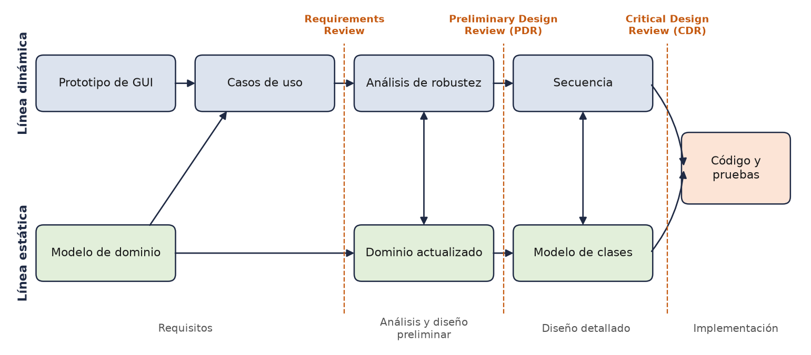
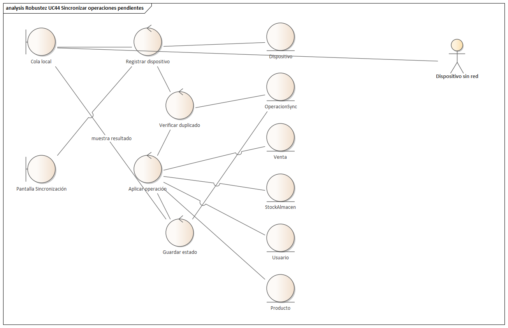
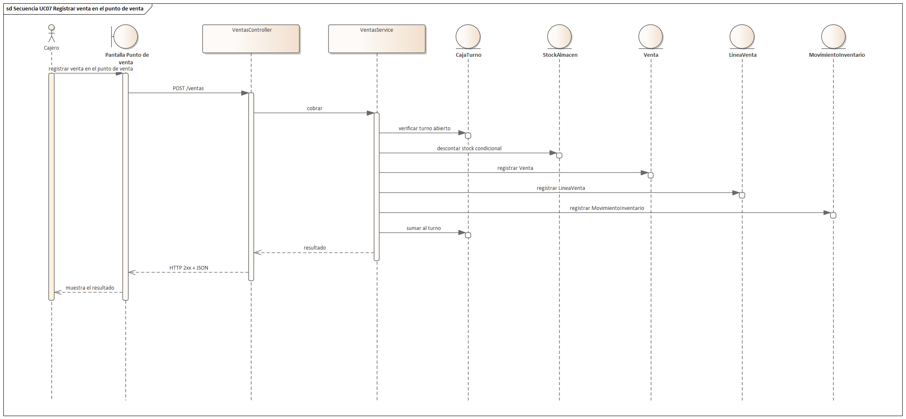

# 9. Proceso de desarrollo con ICONIX

El primer ciclo de EnsayAR se documentó con el Proceso Unificado, cuyo objetivo en ese momento era estabilizar una arquitectura que todavía no existía. El segundo ciclo parte de otra situación: la plataforma funciona, está desplegada y su estructura de monolito modular está probada. Lo que ahora se exige es incorporar capacidades nuevas (modelo SaaS multi-tienda, operación sin conexión con sincronización, reportes generativos con ventas al crédito, analítica con aprendizaje automático y pagos internacionales) sin perder el control sobre qué requisito se resuelve en qué parte del código. Por indicación de la cátedra, el proceso de este ciclo es ICONIX. Este capítulo expone su fundamento teórico y la forma en que se aplica al proyecto.

## 9.0 La metodología ICONIX

ICONIX es un proceso de análisis y diseño orientado a objetos que conduce el desarrollo desde los casos de uso hasta el código mediante una secuencia corta de modelos UML. Usa pocos diagramas, exige que cada uno derive del anterior e introduce un paso intermedio, el análisis de robustez, que obliga a convertir el texto de cada caso de uso en una primera imagen de los objetos que lo realizan.

### 9.0.1 Origen y autores

El proceso surge en ICONIX Software Engineering, empresa fundada por Doug Rosenberg en 1984 y dedicada desde comienzos de los años noventa a la capacitación en análisis y diseño orientado a objetos. En ese período competían tres métodos: el de Grady Booch, la Object Modeling Technique (OMT) de James Rumbaugh y Objectory de Ivar Jacobson. La empresa desarrolló una herramienta que admitía las tres notaciones y, para enseñar a usarla, sintetizó un enfoque que combinaba lo más útil de cada una. Esa síntesis, presentada inicialmente como una aproximación unificada al modelado de objetos, antecedió en algunos años a la unificación que dio origen a UML.

De Jacobson provienen los casos de uso como motor del desarrollo, el análisis de robustez y el uso de diagramas de interacción para repartir comportamiento; de Rumbaugh, el modelo estático del dominio construido con el vocabulario del problema; de Booch, el cuidado en el diseño detallado de clases y operaciones. Los autores reconocen que la parte de Jacobson resultó ser el núcleo: un proceso dirigido por casos de uso no alcanza para llegar al código si no existe un paso que vincule el texto del requisito con los objetos del diseño.

La metodología quedó documentada en una serie de libros de Rosenberg con distintos coautores.

| Año | Título | Autores | Editorial |
|-----|--------|---------|-----------|
| 1999 | Use Case Driven Object Modeling with UML: A Practical Approach | Doug Rosenberg, Kendall Scott | Addison-Wesley |
| 2001 | Applying Use Case Driven Object Modeling with UML: An Annotated e-Commerce Example | Doug Rosenberg, Kendall Scott | Addison-Wesley |
| 2005 | Agile Development with ICONIX Process: People, Process, and Pragmatism | Doug Rosenberg, Matt Stephens, Mark Collins-Cope | Apress |
| 2007 | Use Case Driven Object Modeling with UML: Theory and Practice | Doug Rosenberg, Matt Stephens | Apress |
| 2010 | Design Driven Testing: Test Smarter, Not Harder | Matt Stephens, Doug Rosenberg | Apress |

Kendall Scott acompañó la etapa inicial, centrada en el modelado; el libro de 2001 es un cuaderno de ejercicios sobre una librería en línea, con un capítulo para cada una de las tres revisiones del proceso. Matt Stephens aportó la mirada del desarrollador: el libro de 2007, segunda edición del de 1999 alineada con UML 2.0, incluye ese mismo ejemplo implementado en Java hasta las pruebas unitarias. Esa trayectoria explica la importancia creciente que las obras posteriores dan a la relación entre modelo, código y pruebas.

### 9.0.2 Principios del proceso

**Dirigido por casos de uso.** El caso de uso es la unidad de trabajo: todo modelo posterior se construye para realizar un caso concreto, y todo elemento del diseño debe justificarse por algún paso de algún caso. ICONIX prefiere casos de uso concretos, escritos en términos de lo que el usuario hace sobre las pantallas, antes que casos esenciales e independientes de la tecnología.

**Mínimo: lo justo de UML.** El núcleo se limita a cinco diagramas: modelo de dominio, casos de uso, robustez, secuencia y clases de diseño. Los autores recuerdan que la propia literatura fundacional de UML admite que la mayor parte del modelado se resuelve con una fracción pequeña del lenguaje. Otros diagramas, como los de estados, pueden sumarse cuando el problema lo pida.

**Iterativo e incremental.** Se toma un lote pequeño de casos de uso, se lo lleva por todas las etapas hasta obtener código probado y se repite con el lote siguiente. La secuencia es estricta entre etapas y flexible dentro de ellas.

**Trazable de punta a punta.** Cada frase del caso de uso se reconoce en la robustez, cada controlador reaparece como mensaje en la secuencia, cada mensaje termina como operación de una clase y cada caso tiene pruebas para su curso básico y sus alternos.

**Contra la parálisis por análisis.** Los autores identifican dos fallas opuestas: modelar indefinidamente sin programar, y programar sin haber pensado el diseño. ICONIX ataca la primera con pocos diagramas y criterios claros de terminación, y la segunda exigiendo que el diseño exista antes que el código. Lo describen como algo cercano a un recetario: pasos repetibles y adaptables que indican siempre qué hacer a continuación.

El proceso avanza en dos líneas paralelas. La dinámica parte de los prototipos de interfaz y los casos de uso, pasa por la robustez y llega a la secuencia; la estática parte del modelo de dominio, lo actualiza con lo que descubre la robustez y lo convierte en el modelo de clases que usa el código.

### 9.0.3 Las cuatro etapas y sus hitos

Las tres primeras etapas terminan con una revisión formal que funciona como puerta: el lote no avanza sin superarla. La cuarta termina con la entrega del incremento.

| Etapa | Artefactos | Hito de cierre |
|-------|------------|----------------|
| Requisitos | Requisitos funcionales, modelo de dominio, prototipos de GUI, casos de uso | Revisión de requisitos (Requirements Review) |
| Análisis y diseño preliminar | Robustez por caso de uso, dominio actualizado, casos de uso reescritos | Revisión de diseño preliminar (PDR) |
| Diseño detallado | Secuencia por caso de uso, modelo estático con operaciones | Revisión crítica de diseño (CDR) |
| Implementación | Código, pruebas unitarias, pruebas de integración, modelo sincronizado | Entrega |

**Requisitos.** Los requisitos funcionales son un insumo que puede venir del cliente o del equipo, y se mantienen como lista separada del texto de los casos de uso. En paralelo se construye el modelo de dominio, un diagrama de clases sin operaciones que fija un vocabulario común. Para iniciarlo se sugiere la inspección gramatical: los sustantivos de los documentos disponibles son candidatos a clases o atributos. También se elaboran prototipos o guiones gráficos de la interfaz, porque los casos de uso deben describir el diálogo con pantallas concretas. Luego se identifican los casos de uso, se agrupan en paquetes, se les asignan los requisitos y se escribe un primer borrador de cada uno. La revisión de requisitos comprueba con el cliente que el texto refleje lo esperado, que el dominio cubra las abstracciones principales y que cada caso tenga curso básico y alternos. Los autores admiten revisar por lotes, justo antes de diseñar cada uno.

**Análisis y diseño preliminar.** Para cada caso del lote se dibuja un diagrama de robustez. Al hacerlo aparecen huecos (pasos sin respuesta del sistema, objetos que no están en el dominio, pantallas sin nombre, alternos olvidados) que se corrigen en su origen: se reescribe el texto y se actualiza el dominio. También se nombran todos los controladores. La revisión de diseño preliminar aplica la llamada prueba del resaltador: se recorre cada frase del caso y se marca el elemento del diagrama que le corresponde, hasta que no quede texto sin objeto ni objeto sin texto. Se verifica además que las entidades figuren en el dominio, que se respeten las reglas de conexión y que no se adelante detalle de diseño.

**Diseño detallado.** Se dibuja un diagrama de secuencia por caso de uso, con básico y alternos juntos, cuya función principal es asignar comportamiento a las clases. Con cada operación agregada, el dominio se transforma en modelo estático de diseño, al que se suman las clases técnicas que exige la arquitectura. La revisión crítica de diseño verifica que la secuencia coincida con el texto, que las operaciones estén en las clases adecuadas, que atributos y firmas estén completos, que los programadores consideren construible el diseño y que exista un plan de pruebas.

**Implementación.** El código se escribe a partir del diseño. Las pruebas unitarias se organizan en torno a los controladores de robustez, con al menos una prueba por función lógica. Las pruebas de integración y de escenario se derivan de los casos de uso y recorren el curso básico y cada alterno. La etapa cierra con una revisión de código que es también una actualización del modelo, para que código y diagramas no diverjan antes del siguiente lote.

### 9.0.4 Reglas para escribir casos de uso en ICONIX

Como todo el diseño se deriva del texto, un caso de uso ambiguo produce una robustez ambigua y esa ambigüedad llega al código. Por eso ICONIX fija reglas de redacción.

- **Voz activa, con estructura sustantivo, verbo, sustantivo.** Cada oración indica quién actúa, qué hace y sobre qué objeto. "Se registra la venta" no sirve porque oculta quién actúa.
- **Evento y respuesta.** Se describen los dos lados del diálogo; un paso del usuario sin respuesta del sistema indica comportamiento faltante.
- **Curso básico y cursos alternos.** El básico es el camino en que todo sale bien; los alternos cubren errores y variantes, y concentran buena parte del trabajo real del software.
- **Regla de los dos párrafos.** El curso básico ocupa uno o dos párrafos y cada alterno una o dos oraciones, de modo que el caso completo quepa en un solo diagrama de secuencia.
- **Referencias al dominio y a las pantallas.** Los sustantivos son nombres de clases del dominio, escritos igual que en el modelo, y las fronteras se nombran explícitamente.
- **En contexto del modelo de objetos.** El caso de uso no es una narración libre, sino una especificación del comportamiento en tiempo de ejecución expresada con el vocabulario del dominio y de la interfaz. Esa condición es la que permite diseñar a partir del texto.
- **Requisitos separados y plantillas livianas.** Las declaraciones del tipo "el sistema deberá" quedan en la lista de requisitos, y se evitan plantillas extensas que consumen esfuerzo sin aportar precisión.

En EnsayAR, la ficha del primer ciclo para el registro de venta decía que el sistema "comprueba el disponible". En estilo ICONIX el paso se reescribe así: el Cajero agrega una Variante en la pantalla Punto de Venta; el sistema consulta el StockAlmacén de esa Variante en la Sucursal del Turno abierto y muestra la cantidad disponible. El requisito no cambia, pero quedan visibles una frontera y cuatro entidades que la robustez deberá mostrar.

### 9.0.5 El análisis de robustez

El análisis de robustez es la técnica que distingue a ICONIX. Proviene del trabajo de Jacobson de comienzos de los noventa, pero ICONIX lo volvió obligatorio para cada caso de uso. El diagrama no es un tipo estándar de UML: se construye con clases estereotipadas y los autores lo describen como una imagen de objetos del caso de uso.

**Los tres tipos de objeto.**

- **Frontera (boundary):** punto de contacto entre actor y sistema, como una pantalla o la interfaz con un sistema externo.
- **Entidad (entity):** objeto del dominio, normalmente persistente, tomado del modelo de dominio.
- **Control (controller):** función lógica que conecta fronteras con entidades, como validar, calcular o registrar. Solo a veces termina como clase de control; en general representa un verbo que será una operación.

Fronteras y entidades son sustantivos; los controladores son verbos. De esa lectura surgen las reglas de conexión, en las que la dirección de las flechas no importa.

| Origen / Destino | Actor | Frontera | Control | Entidad |
|------------------|-------|----------|---------|---------|
| Actor | No aplica | Permitida | Prohibida | Prohibida |
| Frontera | Permitida | Prohibida | Permitida | Prohibida |
| Control | Prohibida | Permitida | Permitida | Permitida |
| Entidad | Prohibida | Prohibida | Permitida | Prohibida |

En síntesis, los sustantivos no hablan con sustantivos y los verbos pueden hablar con ambos. El actor solo usa fronteras, porque nunca invoca funciones ni toca datos directamente. Una frontera no accede a una entidad sin un controlador, porque eso pondría lógica de negocio en la pantalla. Dos entidades no se comunican, porque su relación estructural ya está en el dominio y cualquier comportamiento que las involucre es, por definición, un controlador.

**Qué problemas detecta.** Al dibujar la robustez aparecen pasos ambiguos o en voz pasiva, pasos del usuario sin respuesta, objetos que faltan en el dominio o tienen otro nombre, pantallas implícitas, cursos alternos ausentes, casos demasiado extensos (con exceso de controladores) y detalle técnico prematuro, como nombres de tablas.

**Puente entre el qué y el cómo.** El caso de uso expresa qué debe hacer el sistema; la secuencia, cómo lo hacen las clases. Saltar directamente de uno a otro obliga a interpretar el requisito y diseñar en un solo paso, y ahí fallan muchos proyectos. La robustez divide el salto: primero identifica objetos y funciones lógicas sin decidir qué clase hace qué, y recién después se asignan responsabilidades. Cumple así dos funciones, eliminar ambigüedad y descubrir objetos faltantes. Además, sus tres estereotipos se corresponden con el patrón modelo, vista y controlador, lo que permite reconocer en ella la arquitectura técnica.

**De controladores a operaciones o servicios.** En la secuencia, fronteras y entidades pasan a ser líneas de vida y los controladores pasan a ser mensajes. Un controlador simple suele terminar como método de una entidad; uno que coordina varias entidades en una transacción, como operación de un servicio de aplicación; solo una lógica extensa y reutilizable justifica una clase propia.

En EnsayAR conviene una aclaración. NestJS llama controller a las clases que reciben peticiones HTTP, pero en términos de ICONIX esas clases son fronteras del lado del servidor: traducen la petición y delegan. Los controladores de ICONIX corresponden a métodos de los servicios. Así, "cobrar venta" se realiza en la operación cobrar de VentasService, "aplicar lote de operaciones pendientes" en la operación lote de SyncService, e "interpretar pedido en lenguaje natural" en la operación interpretar de ReportesInteligentesService.

### 9.0.6 Diagramas de secuencia y asignación de responsabilidades

ICONIX exige exactamente un diagrama de secuencia por caso de uso, con básico y alternos en el mismo diagrama, porque fragmentar un caso dificulta comprobar que todo quedó cubierto. El diagrama parte de lo que dejó la robustez: actor, fronteras y entidades como líneas de vida, y el texto del caso al margen para alinear cada frase con sus mensajes. Luego se decide qué objeto ejecuta cada controlador; ese es el momento de la asignación de responsabilidades.

Los criterios son los clásicos de calidad de clases: bajo acoplamiento, alta cohesión, y clases suficientes, completas y primitivas. En la práctica, la operación se asigna a la clase que posee la información necesaria, y solo se recurre a un servicio coordinador cuando intervienen varias entidades de igual peso. Los autores llaman prefactorización a este trabajo: mejorar la estructura antes de programar, porque mover una operación en un diagrama cuesta minutos y hacerlo en código probado obliga a reescribir pruebas. Las herramientas lo facilitan, ya que al dibujar un mensaje la operación se agrega a la clase destino.

En esta etapa entra la arquitectura técnica que la robustez omitía. En EnsayAR eso incluye el guard de autenticación, el contexto de tienda que aplica el aislamiento multi-tienda, el registro de claves de idempotencia y el acceso a datos con Prisma. Incluirlos permite verificar en la revisión crítica, por ejemplo, que ninguna operación consulta datos sin la tienda de la sesión fijada.

### 9.0.7 Trazabilidad

Si cada etapa deriva de la anterior, un requisito puede seguirse hasta la prueba que lo verifica y, en sentido inverso, cada clase y cada prueba se justifican por un requisito. ICONIX recomienda registrar esa relación en una matriz. Algunas filas de la matriz de EnsayAR ilustran su forma.

| Caso de uso | Controladores de robustez | Clase y operación | Prueba |
|-------------|---------------------------|-------------------|--------|
| UC07 Registrar venta en el punto de venta | verificar turno abierto, descontar stock condicional, registrar venta, sumar al turno | VentasService.cobrar | Venta, uuid duplicado y conflicto en verificar:offline |
| UC38 Suscribirse y crear tienda | verificar slug, cobrar suscripción, aprovisionar tienda | PlataformaService.suscribir | Pago rechazado, aprobado e idempotente en verificar:saas |
| UC40 Cambiar de tienda | listar tiendas de la cuenta, emitir token de tienda | AuthService.cambiarTienda | Misma cuenta en dos tiendas sin nuevo inicio de sesión en verificar:saas |
| UC44 Sincronizar operaciones pendientes | registrar dispositivo, verificar duplicado, aplicar operación, guardar estado | SyncService.lote | Reenvío de lote y última unidad en verificar:offline |
| UC48 Generar reporte por texto o voz | interpretar pedido, validar especificación, compilar SQL, ejecutar aislado por tienda | ReportesInteligentesService.generar | Especificaciones, inyección y aislamiento en verificar:reportes |
| UC51 Registrar abono de crédito | descontar saldo condicional, registrar abono, sumar a caja | CreditosController.abonar | Abono repetido y abonos simultáneos en verificar:reportes |

La matriz completa, de UC01 a UC54, se presenta en el apartado de implementación y pruebas. En la revisión crítica permite detectar casos sin secuencia; en la implementación, operaciones que nadie pidió; y en la defensa, mostrar de inmediato cómo se realiza y se verifica cualquier funcionalidad.

### 9.0.8 ICONIX frente a otros procesos

**Frente al Proceso Unificado.** Ambos son dirigidos por casos de uso, iterativos e incrementales, usan UML y heredan de Jacobson los estereotipos de frontera, control y entidad. Difieren en alcance, estructura y riesgo prioritario.

| Aspecto | Proceso Unificado | ICONIX |
|---------|-------------------|--------|
| Naturaleza | Marco amplio y adaptable | Proceso mínimo, del caso de uso al código |
| Estructura | Fases (inicio, elaboración, construcción, transición) cruzadas con disciplinas | Cuatro etapas recorridas por cada lote de casos de uso |
| Hitos | Objetivos, arquitectura, capacidad operativa inicial, entrega del producto | Revisión de requisitos, PDR, CDR, entrega |
| Centro | Casos de uso y arquitectura | Casos de uso y trazabilidad |
| Riesgo que ataca primero | Técnico, con arquitectura ejecutable temprana | Ambigüedad de requisitos y parálisis por análisis |
| Paso de análisis a diseño | Modelo de análisis, a menudo omitido en la práctica | Robustez obligatoria por caso de uso |
| Casos de uso | Plantillas detalladas con flujos y subflujos | Dos párrafos, voz activa, dominio y pantallas |
| Diseño detallado | Varios modelos posibles | Una secuencia por caso de uso y el modelo estático |
| Pruebas | Disciplina con flujo propio | Derivadas de controladores y casos de uso |
| Gestión | Incluye planificación y configuración | Casi no la aborda |

La diferencia práctica decisiva es la robustez: el Proceso Unificado prevé un modelo de análisis con los mismos estereotipos, pero como artefacto opcional; ICONIX lo vuelve obligatorio y lo somete a una revisión formal.

**Frente a Scrum y XP.** Scrum es un marco de gestión: organiza el trabajo en iteraciones con roles y eventos, pero no prescribe cómo analizar ni diseñar. ICONIX es un proceso de ingeniería que dice qué modelos construir y en qué orden, pero casi nada sobre planificación. Por eso pueden combinarse: un lote de ICONIX puede ocupar uno o varios sprints. Con XP la relación es más tensa. XP parte de historias de usuario, confía en un cliente presente, deja que el diseño emerja guiado por las pruebas y lo mejora con refactorización continua. Rosenberg y Stephens publicaron en 2003 una crítica de ese enfoque, y ICONIX propone lo contrario: diseñar antes de programar, prefactorizar en lugar de refactorizar y derivar las pruebas del diseño, idea que luego desarrollaron como pruebas dirigidas por el diseño.

| Aspecto | Scrum | XP | ICONIX |
|---------|-------|----|--------|
| Tipo | Marco de gestión | Prácticas de programación | Proceso de análisis y diseño |
| Requisito | Elemento del backlog | Historia de usuario | Caso de uso con básico y alternos |
| Diseño previo | No lo prescribe | Mínimo, emergente | Explícito y revisado |
| Origen de las pruebas | No lo prescribe | Escritas antes del código | Derivadas del modelo |

**Versión ágil de ICONIX.** En el libro de 2005 los autores definen un subconjunto de doce prácticas. Cuatro son propias del proceso: análisis de requisitos con eliminación de ambigüedades, análisis del dominio como lenguaje común con el cliente, diseño de la interacción para reducir cambios de requisitos y prefactorización guiada por el modelo. Ocho son ágiles: pruebas intensivas, entregas pequeñas y frecuentes, integración frecuente, sincronización de modelo y código después de cada entrega, planificación ágil, responsabilidad colectiva, comunicación del equipo e iteraciones cortas. Los valores que las sostienen son comunicación, retroalimentación temprana, simplicidad, y juicio y equilibrio. Para EnsayAR resulta clave la sincronización de modelo y código: se acepta que diverjan durante una iteración, pero al final de cada entrega se realinean, actualizando solo lo necesario y corrigiendo el análisis si la implementación mostró que no se correspondía con la realidad.

### 9.0.9 Herramientas: Enterprise Architect

Enterprise Architect, de Sparx Systems, incluye en su instalación una tecnología de modelado para ICONIX que agrega páginas de herramientas específicas para los diagramas de análisis, casos de uso, clases, secuencia y actividades. La página de análisis ofrece los tres estereotipos de robustez como elementos propios, y el vinculador rápido sugiere solo conexiones válidas entre ellos. La herramienta permite además escribir escenarios estructurados en un caso de uso y generar desde ellos una robustez preliminar, y crear la operación en la clase destino al dibujar un mensaje de secuencia, lo que mantiene sincronizados los modelos dinámico y estático. Sparx e ICONIX publicaron también un complemento para pruebas dirigidas por el diseño que genera la estructura de las secuencias a partir de la robustez, transforma controladores en casos de prueba e incorpora reglas de validación de robustez.

En EnsayAR, el modelo del segundo ciclo es el archivo `docs/segundo-parcial/diagramas/EnsayAR-ICONIX.eapx`. Conserva intacto el modelo del primer ciclo y le suma el paquete "ICONIX segundo parcial", ordenado según las etapas del proceso: 1 Requisitos (31 requisitos y su asignación a casos de uso), 2 Modelo de dominio (41 clases en cinco vistas y una vista completa), 3 Casos de uso (un paquete por lote, con 20 diagramas), 4 Robustez (un paquete por caso con sus controladores; fronteras y entidades compartidas), 5 Secuencias (una por caso), 6 Diseño detallado (clases de diseño por módulo, con sus operaciones y dependencias) y 7 Arquitectura (componentes y despliegue). Las entidades de robustez están vinculadas por una dependencia «trace» a su clase del dominio.

El modelo no se dibuja a mano. El archivo `docs/segundo-parcial/iconix/casos.py` describe cada caso de uso con sus actores, fronteras, curso básico, cursos alternos, controladores con las entidades que tocan, la ruta HTTP y la clase y operación que lo realizan. El script `generar_ea.py` recorre esa descripción y construye el modelo con la interfaz de automatización de Enterprise Architect: crea los elementos, deriva los mensajes de cada secuencia a partir de los controladores de la robustez, agrega las operaciones a las clases de diseño, toma atributos y asociaciones del dominio directamente de `schema.prisma` y exporta los 156 diagramas como imágenes. Así se cumple de forma mecánica la regla de ICONIX de que cada diagrama derive del anterior: si cambia el texto de un caso, se regeneran su robustez, su secuencia y las clases afectadas.

### 9.0.10 Ventajas y críticas

**Ventajas.** ICONIX ofrece un camino corto y verificable del requisito al código. Al usar pocos diagramas se aprende rápido y el modelado no se vuelve un fin en sí mismo. La robustez detecta defectos de requisitos cuando corregirlos es barato, y las tres revisiones distribuyen el control de calidad a lo largo del proceso. La trazabilidad facilita estimar, porque cada caso tiene un tamaño acotado, y probar, porque los casos de prueba salen de los cursos del caso de uso. Además se adapta a equipos pequeños y se combina bien con prácticas ágiles.

**Críticas.**

- Dice poco sobre arquitectura: no ofrece un mecanismo para decisiones transversales como el aislamiento multi-tienda o el despliegue.
- Casi no aborda la gestión del proyecto, por lo que debe complementarse.
- Los requisitos que no se expresan como diálogo, como rendimiento, seguridad o procesos sin actor humano, encajan mal en los casos de uso.
- La robustez no es UML estándar y depende del soporte de la herramienta.
- Exigir robustez y secuencia para cada caso puede ser costoso en casos sencillos de alta, baja y modificación.
- Sin sincronización disciplinada entre modelo y código, los diagramas envejecen y la trazabilidad se vuelve formal.

En EnsayAR estas críticas se atienden así: las decisiones de arquitectura provienen del primer ciclo y de los capítulos de fundamentación, y entran al diseño detallado como restricciones; los requisitos no funcionales, como la ventana máxima sin conexión o el aislamiento entre tiendas, se registran en la lista de requisitos y se trazan a los casos afectados; y en los casos heredados sencillos la robustez y la secuencia se dibujan con el detalle mínimo que permite verificar las reglas.

### 9.0.11 Por qué ICONIX en el segundo ciclo de EnsayAR

La elección responde a la exigencia de la cátedra de aplicar un proceso distinto del Proceso Unificado y de Scrum, pero también es coherente con el momento del proyecto. El primer ciclo enfrentaba incertidumbre técnica: había que demostrar que la venta concurrente no dejaba stock negativo, que el probador funcionaba en el dispositivo y que los reportes en lenguaje natural se limitaban a consultas seguras. Para eso convenía la orientación del Proceso Unificado hacia una arquitectura ejecutable temprana.

En el segundo ciclo la arquitectura ya existe: el monolito modular en NestJS, los clientes React y React Native, PostgreSQL y el despliegue en la nube no se reemplazan. El riesgo ahora es integrar diecinueve casos de uso nuevos (UC36 a UC54), varios con reglas delicadas como la idempotencia, los conflictos de stock entre dispositivos sin conexión o el aislamiento entre tiendas, sin que ninguno quede a medio implementar o sin verificar. Ese es el problema para el que ICONIX está pensado: llevar cada caso de uso al código con trazabilidad completa y revisada. Además, como la cátedra anunció preguntas sobre cualquier parte del sistema sin mirar la aplicación, contar con robustez, secuencia, operaciones y pruebas por caso de uso permite responder con precisión dónde y cómo se resuelve cada requisito.

### 9.0.12 Organización iterativa por lotes

El ciclo se divide en seis lotes. Cada uno recorre las cuatro etapas por separado, sobre un dominio y un modelo de clases compartidos.

| Lote | Contenido | Casos de uso | Enfoque |
|------|-----------|--------------|---------|
| Lote 0 | Casos heredados | UC01 a UC35 | Revisión con robustez y secuencia por el contexto multi-tienda y la operación sin conexión |
| Lote 1 | SaaS multi-tienda | UC36 a UC41 | Registro, verificación de correo, suscripción con creación de tienda, renovación, cambio de tienda y métricas |
| Lote 2 | Operación sin conexión | UC42 a UC47 | Venta y altas sin red en web y móvil, sincronización, conflicto de stock, ventana configurable y notificaciones push |
| Lote 3 | Reportes y crédito | UC48 a UC51 | Reportes por voz o texto en pantalla, PDF o Excel, ventas al crédito y abonos |
| Lote 4 | Analítica | UC52 y UC53 | Modelos supervisados y no supervisados con datos sintéticos y tableros |
| Lote 5 | Pagos | UC54 | Medios de pago para países de habla hispana con pasarelas en modo de pruebas |

Los lotes 4 y 5 están a cargo de otro integrante, con las mismas reglas: casos escritos según ICONIX, diagramas en el mismo modelo y pruebas derivadas de los casos. Sus casos de uso figuran ya en el modelo con el alcance acordado y se ajustarán a los nombres definitivos de su implementación. El lote 0 se justifica porque el segundo ciclo modifica los casos heredados de forma transversal: todos se ejecutan dentro de una tienda, y varios, como la venta o el alta de clientas, deben funcionar sin conexión. La robustez revela en qué pasos interviene el contexto de tienda y dónde aparece un alterno nuevo por falta de red.

### 9.0.13 Reutilización de los artefactos del primer ciclo

ICONIX no obliga a descartar lo producido con el Proceso Unificado; varios artefactos entran directamente en sus etapas.

| Artefacto del primer ciclo | Etapa de ICONIX | Adaptación |
|----------------------------|-----------------|------------|
| Fichas de UC01 a UC35 | Requisitos | Reescritura en voz activa, con alternos, dominio y pantallas |
| Modelo de dominio de la elaboración | Requisitos y análisis | Se agregan Cuenta, Tienda, Plan, Suscripción, OperacionSync y CuentaPorCobrar, entre otras |
| Pantallas implementadas en web y móvil | Requisitos | Funcionan como prototipos de GUI ya validados |
| Diagramas de comunicación y clases de análisis | Análisis y diseño preliminar | Base de la robustez, con los mismos estereotipos |
| Secuencias de inicio de sesión, venta y cola sin conexión | Diseño detallado | Se actualizan con contexto de tienda e idempotencia |
| Diseño físico de datos | Diseño detallado | Modelo estático de persistencia, con tienda en los modelos de negocio |
| Plan y casos de prueba | Implementación | Se complementan con los scripts de verificación |

Esta reutilización refleja la idea de incremento planteada por la cátedra: el segundo ciclo extiende la versión anterior en lugar de reconstruirla.

### 9.0.14 Hitos y calendario del ciclo

Cada lote atraviesa las tres revisiones. Dado el ciclo corto y el equipo pequeño, se realizan como sesiones breves con listas de verificación basadas en las recomendaciones de los autores, y su resultado se registra en un acta corta. Las fechas son aproximadas.

| Hito | Lotes | Fecha aproximada (noviembre de 2026) |
|------|-------|--------------------------------------|
| Inicio del ciclo y análisis de la consigna | Todos | Primeros días del mes |
| Revisión de requisitos | 1 a 5, y relectura del 0 | 3 y 4 |
| Revisión de diseño preliminar | 1 a 3 | 5 y 6 |
| Revisión crítica de diseño | 1 a 3 | 6 y 7 |
| Implementación y verificación | 1 a 3 | Hasta el 8 |
| PDR y CDR | 0, 4 y 5 | 9 y 10 |
| Revisión de código y actualización del modelo | Todos | 10 |
| Entrega del documento en PDF | Todos | 11, hasta las 8:00 |
| Presentación y defensa | Todos | 11 |

Los lotes 1 a 3 se implementaron primero porque concentran lo que la cátedra anunció que se pondría a prueba en la defensa, como crear varias tiendas o vender la última unidad en dos dispositivos sin conexión. Para ellos, parte de los diagramas se trabajó como bocetos antes de programar y se consolida en Enterprise Architect durante la revisión de código y actualización del modelo, que es la práctica de sincronización propuesta por la versión ágil del proceso.

### 9.0.15 Los scripts de verificación como pruebas de integración

ICONIX distingue pruebas unitarias, que verifican controladores, y pruebas de integración y de escenario, que verifican casos de uso completos contra el sistema en ejecución. En EnsayAR, este segundo nivel lo cubren cuatro scripts de la carpeta de scripts del backend, que se ejecutan contra la API levantada y una base de datos real.

| Script | Lote | Comprobaciones | Escenarios principales |
|--------|------|----------------|------------------------|
| verificar:tenancy | 0 y 1 | Aislamiento de datos | Lecturas filtradas por tienda, fallo sin tienda en contexto, registros ajenos invisibles e inmodificables |
| verificar:saas | 1 | 15 | Verificación de correo, pago rechazado y aprobado, reintento sin doble cobro, catálogos aislados, límites del plan, cambio de tienda, suscripción vencida y métricas |
| verificar:offline | 2 | 14 | Identificadores del dispositivo, última unidad en dos cajas, reversión de venta, reenvío sin duplicados, envíos simultáneos, pago QR sin red rechazado y ventana de siete días |
| verificar:reportes | 3 | 24 | Pedidos dictados complejos, agrupación y orden, parámetros separados del SQL, inyección, aislamiento, Excel y PDF, crédito y abonos repetidos o simultáneos |

La correspondencia con ICONIX es directa: cada chequeo nombra un escenario de un caso de uso y verifica su poscondición. La última unidad vendida en dos cajas sin conexión es el curso alterno de conflicto de stock del caso de sincronización; el abono repetido con la misma clave es el alterno de reintento del caso de abono al crédito. Por eso cada script ocupa la columna de pruebas de la matriz de trazabilidad, y las pruebas unitarias del backend, como la de concurrencia de la venta heredada, completan el nivel de los controladores. El enfoque coincide con las pruebas dirigidas por el diseño de Stephens y Rosenberg: las pruebas no definen el diseño, sino que comprueban que el diseño aprobado en la revisión crítica quedó bien implementado.

### 9.0.16 Organización del resto del capítulo

Los apartados siguientes siguen el orden de las etapas de ICONIX para todos los lotes.

- **9.1 Requisitos.** Requisitos del segundo ciclo, modelo de dominio actualizado, prototipos de GUI, diagramas de casos de uso por paquete, texto de UC01 a UC54 con las convenciones de ICONIX y acta de la revisión de requisitos.
- **9.2 Análisis y diseño preliminar.** Diagramas de robustez por caso de uso y lote, controladores identificados, cambios al dominio y al texto, y acta de la revisión de diseño preliminar.
- **9.3 Diseño detallado.** Diagramas de secuencia, modelo estático con operaciones, decisiones de arquitectura multi-tienda y de sincronización incorporadas, y acta de la revisión crítica.
- **9.4 Implementación y pruebas.** Correspondencia entre diseño y módulos, pruebas unitarias, scripts de verificación, matriz de trazabilidad completa y resultado de la revisión de código y actualización del modelo.

## Referencias del capítulo

1. Rosenberg, D. y Stephens, M. (2007). Use Case Driven Object Modeling with UML: Theory and Practice. Berkeley, CA: Apress. DOI: 10.1007/978-1-4302-0369-8. https://link.springer.com/book/10.1007/978-1-4302-0369-8
2. Rosenberg, D., Stephens, M. y Collins-Cope, M. (2005). Agile Development with ICONIX Process: People, Process, and Pragmatism. Berkeley, CA: Apress. DOI: 10.1007/978-1-4302-0009-3. https://link.springer.com/book/10.1007/978-1-4302-0009-3
3. Rosenberg, D. y Scott, K. (2001). Applying Use Case Driven Object Modeling with UML: An Annotated e-Commerce Example. Boston: Addison-Wesley. ISBN 0-201-73039-1. https://www.informit.com/store/applying-use-case-driven-object-modeling-with-uml-an-9780201730395
4. Rosenberg, D. y Scott, K. (1999). Use Case Driven Object Modeling with UML: A Practical Approach. Reading, MA: Addison-Wesley.
5. Stephens, M. y Rosenberg, D. (2010). Design Driven Testing: Test Smarter, Not Harder. Berkeley, CA: Apress. DOI: 10.1007/978-1-4302-2944-5. https://link.springer.com/book/10.1007/978-1-4302-2944-5
6. Stephens, M. y Rosenberg, D. (2003). Extreme Programming Refactored: The Case Against XP. Berkeley, CA: Apress.
7. Jacobson, I., Christerson, M., Jonsson, P. y Övergaard, G. (1992). Object-Oriented Software Engineering: A Use Case Driven Approach. Wokingham: Addison-Wesley.
8. Jacobson, I., Booch, G. y Rumbaugh, J. (1999). The Unified Software Development Process. Reading, MA: Addison-Wesley.
9. Sparx Systems. ICONIX. Enterprise Architect User Guide, versión 17.2. https://www.sparxsystems.com/enterprise_architect_user_guide/17.2/modeling_domains/iconix_process.html
10. Sparx Systems. Model Driven Generation (MDG) Technologies for Enterprise Architect. https://sparxsystems.com/resources/mdg_tech/
