# 9.2 Análisis y diseño preliminar

Para cada caso de uso se dibujó su diagrama de robustez con los tres estereotipos de ICONIX: fronteras (pantallas e interfaces externas), controles (funciones lógicas, que son verbos) y entidades (clases del dominio). Las conexiones respetan las reglas del proceso: el actor solo habla con fronteras, las fronteras solo con controles y las entidades solo con controles. Cada entidad de robustez está vinculada por «trace» a su clase del dominio.

Cada diagrama se lee de izquierda a derecha siguiendo el curso básico: actor, pantalla, cadena de controles en el orden del texto y, a la derecha, las entidades que cada control lee o modifica. Cuando un control habla con un sistema externo, la frontera de ese sistema y su actor secundario aparecen en el extremo derecho.

## Lote 0: Casos heredados del primer ciclo, revisados con robustez y secuencia

### Robustez UC01 Consultar catálogo

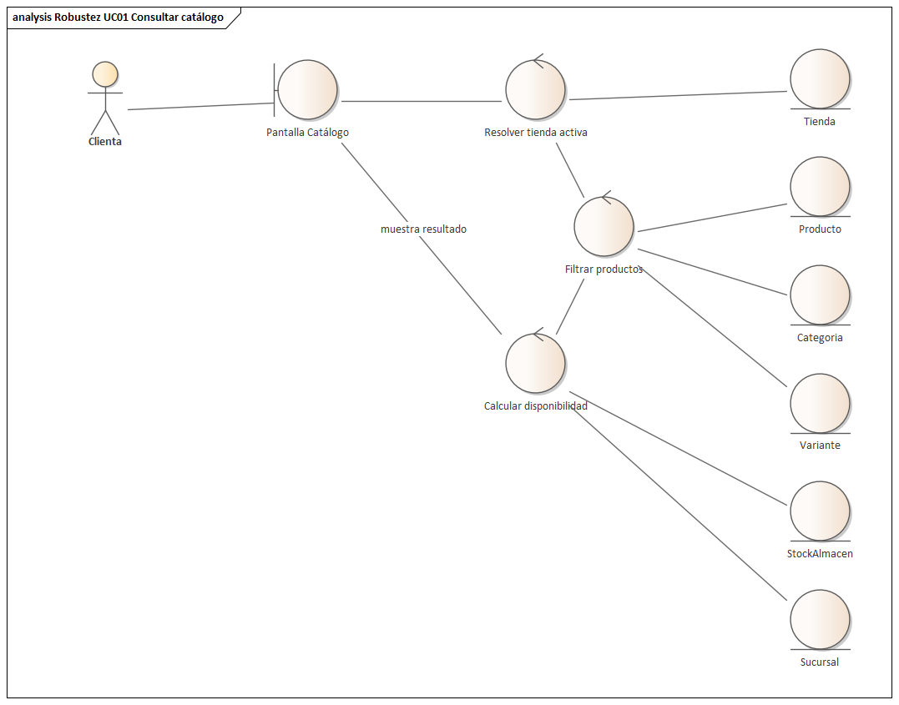

| Control | Entidades o fronteras que usa |
|---|---|
| Resolver tienda activa | Tienda |
| Filtrar productos | Producto, Categoria y Variante |
| Calcular disponibilidad | StockAlmacen y Sucursal |

### Robustez UC02 Ver ficha y variantes

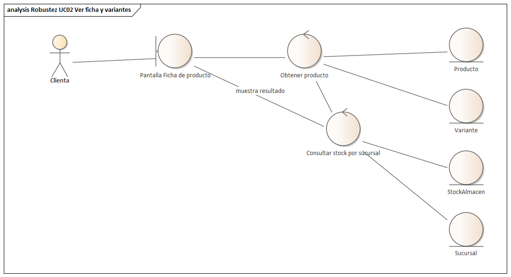

| Control | Entidades o fronteras que usa |
|---|---|
| Obtener producto | Producto y Variante |
| Consultar stock por sucursal | StockAlmacen y Sucursal |

### Robustez UC03 Usar el probador virtual

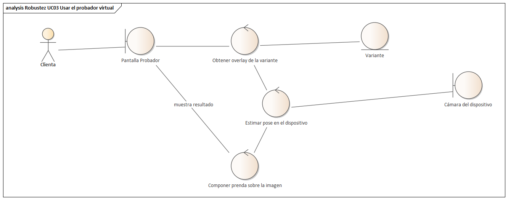

| Control | Entidades o fronteras que usa |
|---|---|
| Obtener overlay de la variante | Variante |
| Estimar pose en el dispositivo | Cámara del dispositivo |
| Componer prenda sobre la imagen | Cálculo interno |

### Robustez UC04 Consultar la ficha con el asistente

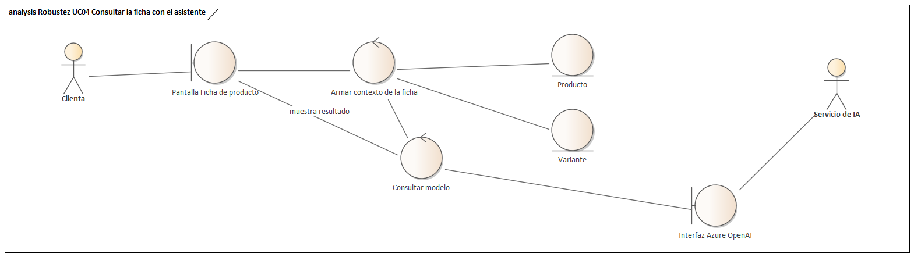

| Control | Entidades o fronteras que usa |
|---|---|
| Armar contexto de la ficha | Producto y Variante |
| Consultar modelo | Interfaz Azure OpenAI |

### Robustez UC05 Comprar en línea

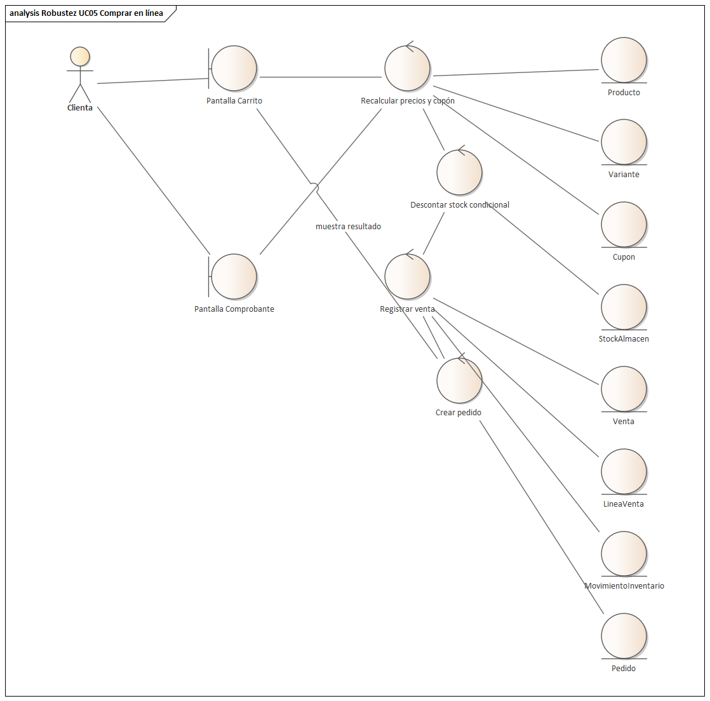

| Control | Entidades o fronteras que usa |
|---|---|
| Recalcular precios y cupón | Producto, Variante y Cupon |
| Descontar stock condicional | StockAlmacen |
| Registrar venta | Venta, LineaVenta y MovimientoInventario |
| Crear pedido | Pedido |

### Robustez UC06 Abrir caja

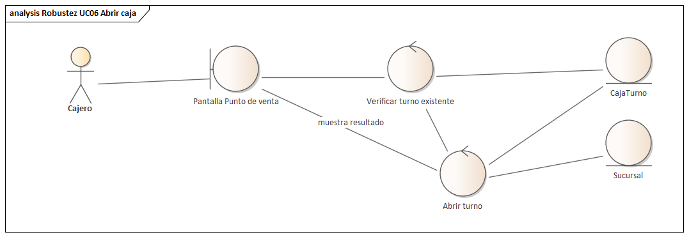

| Control | Entidades o fronteras que usa |
|---|---|
| Verificar turno existente | CajaTurno |
| Abrir turno | CajaTurno y Sucursal |

### Robustez UC07 Registrar venta en el punto de venta

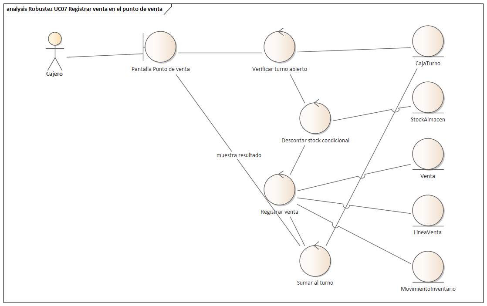

| Control | Entidades o fronteras que usa |
|---|---|
| Verificar turno abierto | CajaTurno |
| Descontar stock condicional | StockAlmacen |
| Registrar venta | Venta, LineaVenta y MovimientoInventario |
| Sumar al turno | CajaTurno |

**Hallazgo de la robustez.** La robustez mostró que el cobro toca cuatro entidades y que el turno de caja debe verificarse antes del stock; el orden de los controladores quedó fijado así en el texto.

### Robustez UC08 Cerrar caja

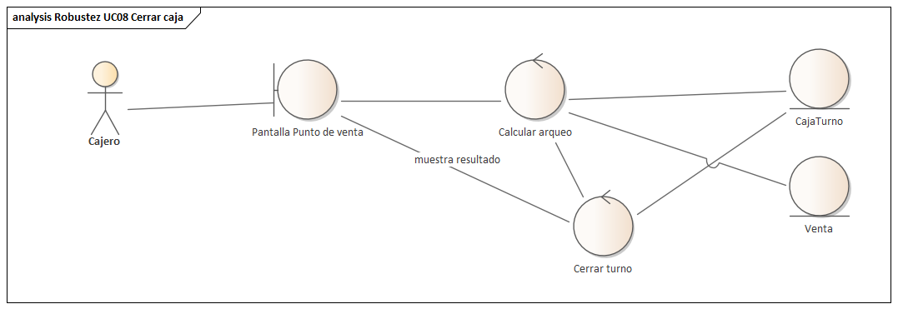

| Control | Entidades o fronteras que usa |
|---|---|
| Calcular arqueo | CajaTurno y Venta |
| Cerrar turno | CajaTurno |

**Hallazgo de la robustez.** Al dibujar el cierre apareció la dependencia con la cola offline: un turno no debe cerrarse con operaciones pendientes. Se agregó el alterno 1a.

### Robustez UC09 Administrar catálogo

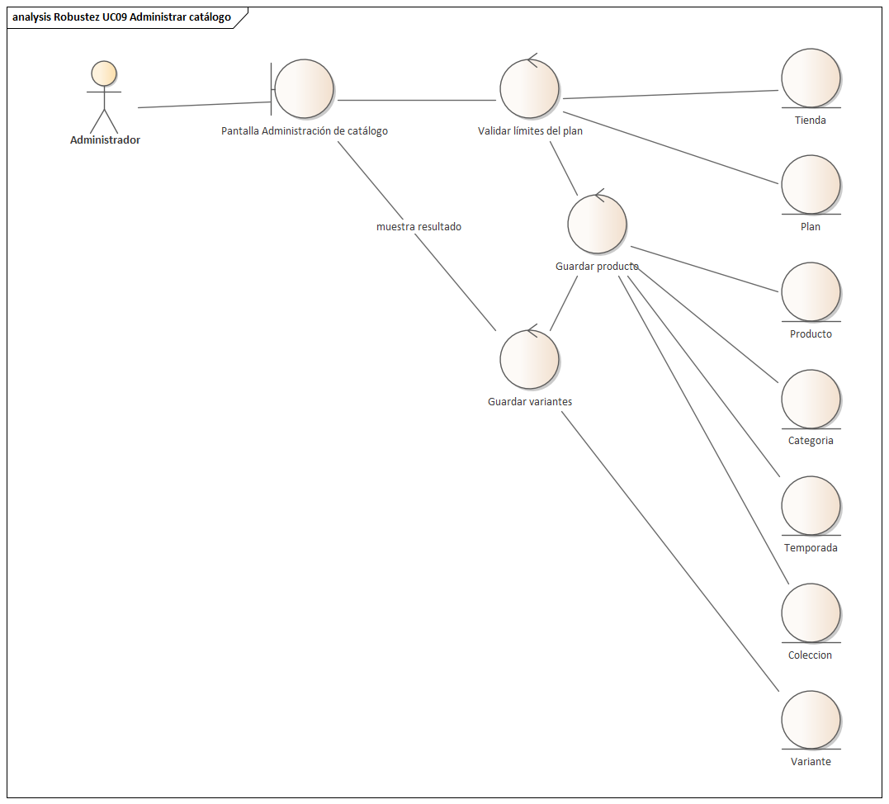

| Control | Entidades o fronteras que usa |
|---|---|
| Validar límites del plan | Tienda y Plan |
| Guardar producto | Producto, Categoria, Temporada y Coleccion |
| Guardar variantes | Variante |

### Robustez UC10 Pedir reporte predefinido

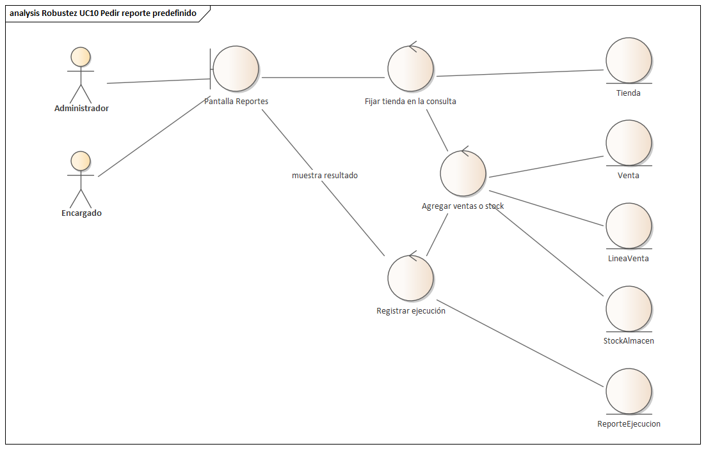

| Control | Entidades o fronteras que usa |
|---|---|
| Fijar tienda en la consulta | Tienda |
| Agregar ventas o stock | Venta, LineaVenta y StockAlmacen |
| Registrar ejecución | ReporteEjecucion |

### Robustez UC11 Reservar una prenda

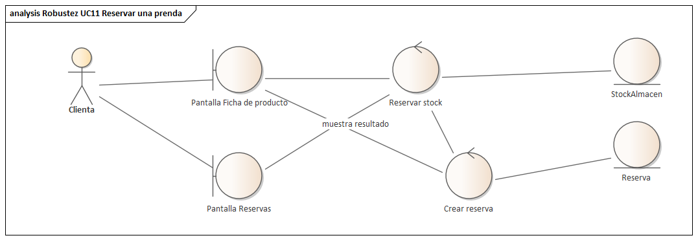

| Control | Entidades o fronteras que usa |
|---|---|
| Reservar stock | StockAlmacen |
| Crear reserva | Reserva |

### Robustez UC12 Atender reservas

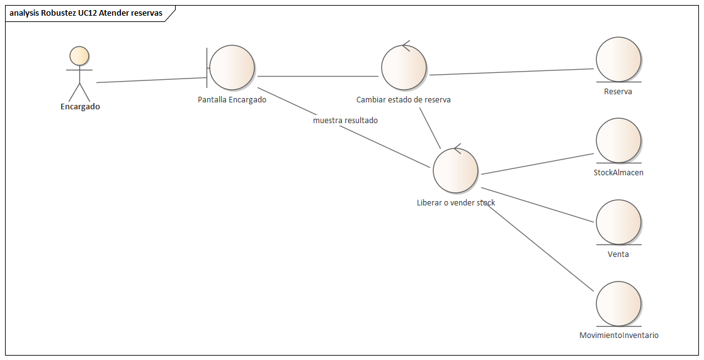

| Control | Entidades o fronteras que usa |
|---|---|
| Cambiar estado de reserva | Reserva |
| Liberar o vender stock | StockAlmacen, Venta y MovimientoInventario |

### Robustez UC13 Ingresar mercadería

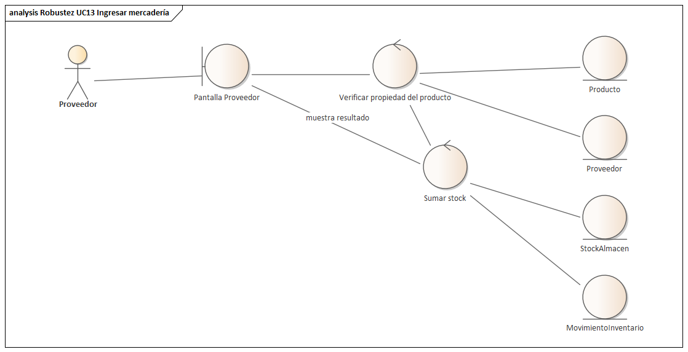

| Control | Entidades o fronteras que usa |
|---|---|
| Verificar propiedad del producto | Producto y Proveedor |
| Sumar stock | StockAlmacen y MovimientoInventario |

### Robustez UC14 Registrarse como clienta

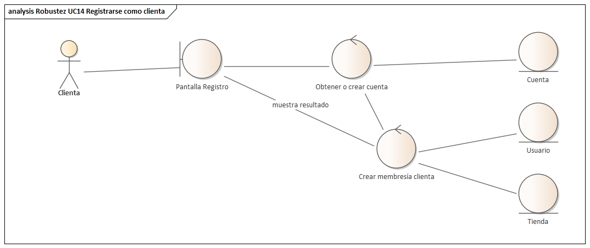

| Control | Entidades o fronteras que usa |
|---|---|
| Obtener o crear cuenta | Cuenta |
| Crear membresía clienta | Usuario y Tienda |

### Robustez UC15 Iniciar y cerrar sesión

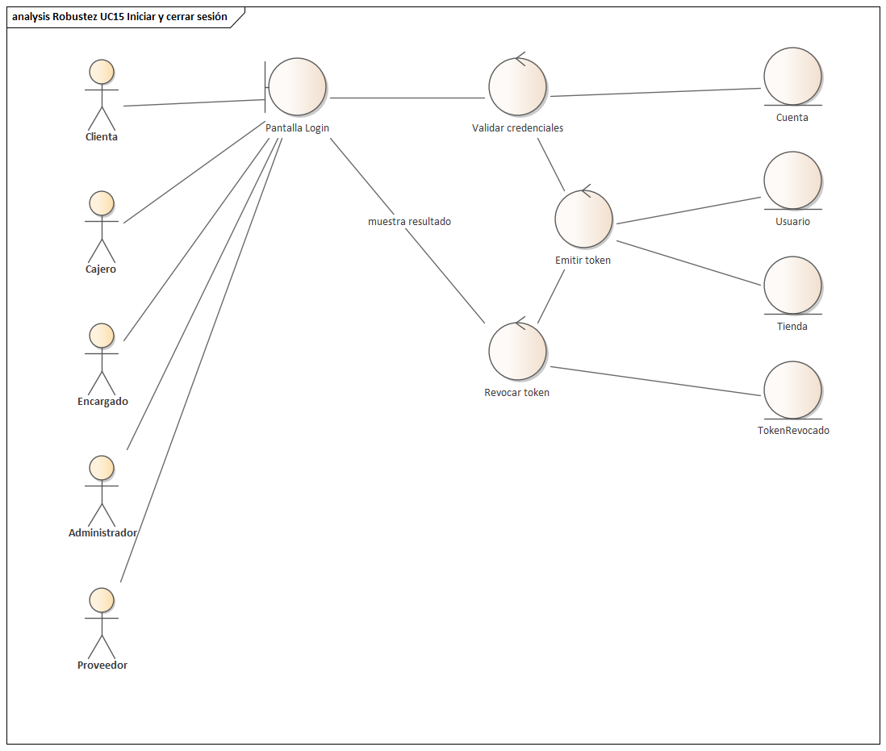

| Control | Entidades o fronteras que usa |
|---|---|
| Validar credenciales | Cuenta |
| Emitir token | Usuario y Tienda |
| Revocar token | TokenRevocado |

**Hallazgo de la robustez.** El inicio de sesión necesitaba dos entidades distintas: Cuenta (identidad global) y Usuario (membresía en una tienda). El dominio se separó en consecuencia.

### Robustez UC16 Cambiar clave

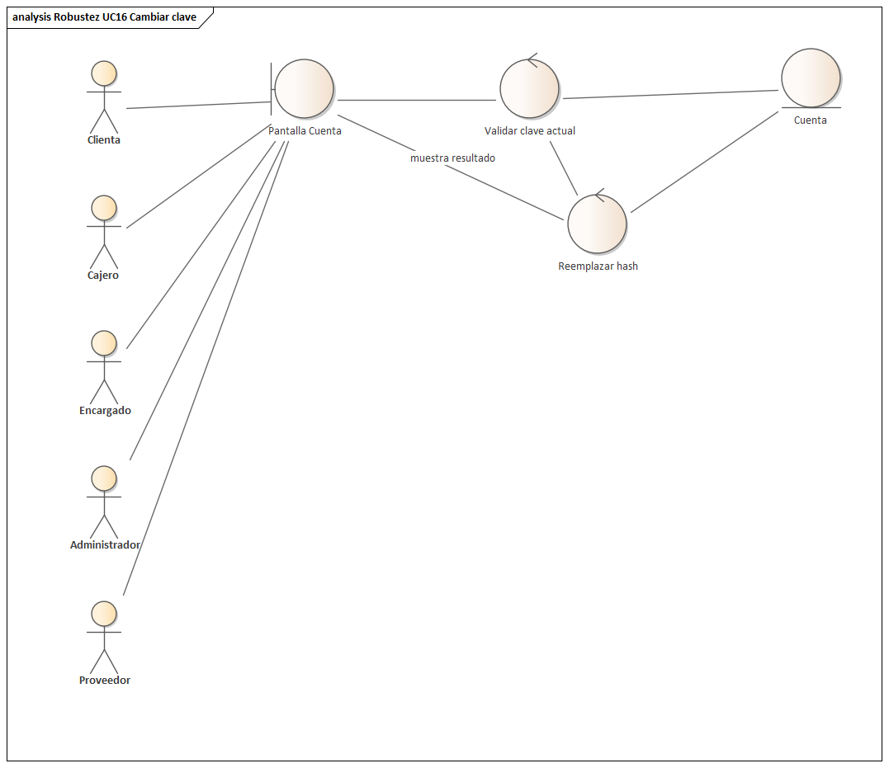

| Control | Entidades o fronteras que usa |
|---|---|
| Validar clave actual | Cuenta |
| Reemplazar hash | Cuenta |

### Robustez UC17 Gestionar favoritos

| Control | Entidades o fronteras que usa |
|---|---|
| Guardar o quitar favorito | Favorito y Producto |

### Robustez UC18 Gestionar perfil y direcciones

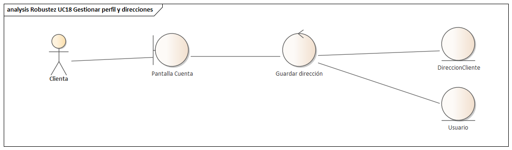

| Control | Entidades o fronteras que usa |
|---|---|
| Guardar dirección | DireccionCliente y Usuario |

### Robustez UC19 Ver historial de compras

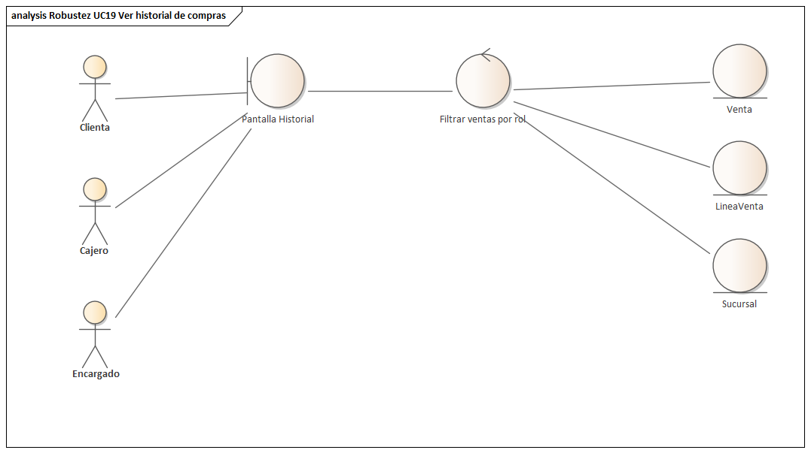

| Control | Entidades o fronteras que usa |
|---|---|
| Filtrar ventas por rol | Venta, LineaVenta y Sucursal |

### Robustez UC20 Opinar un producto

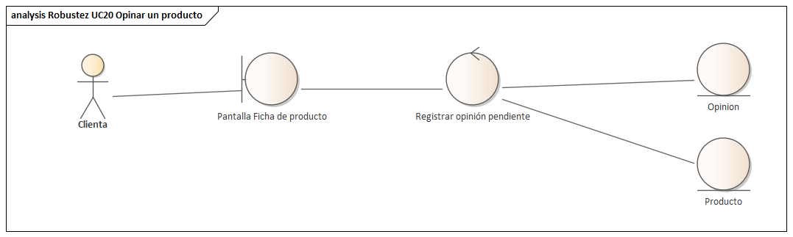

| Control | Entidades o fronteras que usa |
|---|---|
| Registrar opinión pendiente | Opinion y Producto |

### Robustez UC21 Pedir alerta de producto

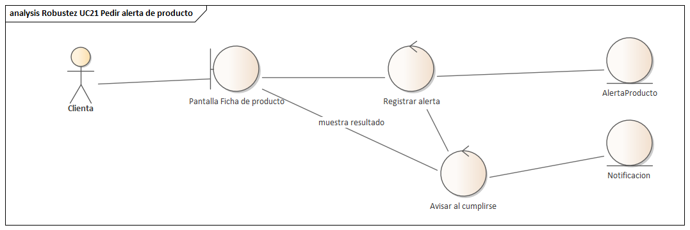

| Control | Entidades o fronteras que usa |
|---|---|
| Registrar alerta | AlertaProducto |
| Avisar al cumplirse | Notificacion |

### Robustez UC22 Aplicar cupón

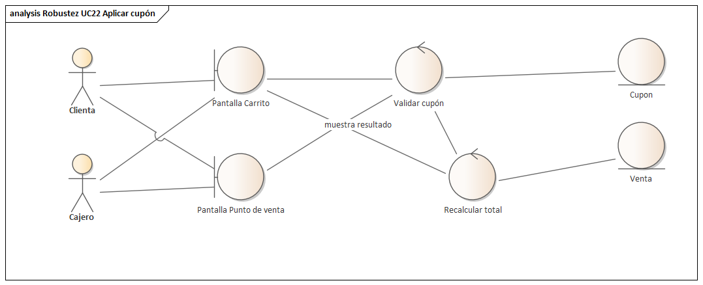

| Control | Entidades o fronteras que usa |
|---|---|
| Validar cupón | Cupon |
| Recalcular total | Venta |

### Robustez UC23 Gestionar usuarios

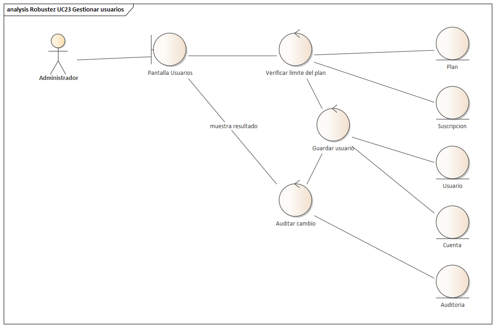

| Control | Entidades o fronteras que usa |
|---|---|
| Verificar límite del plan | Plan y Suscripcion |
| Guardar usuario | Usuario y Cuenta |
| Auditar cambio | Auditoria |

**Hallazgo de la robustez.** El alta de usuarios no tenía control de límites. La robustez agregó el control Verificar límite del plan y las entidades Plan y Suscripcion.

### Robustez UC24 Gestionar sucursales, temporadas y colecciones

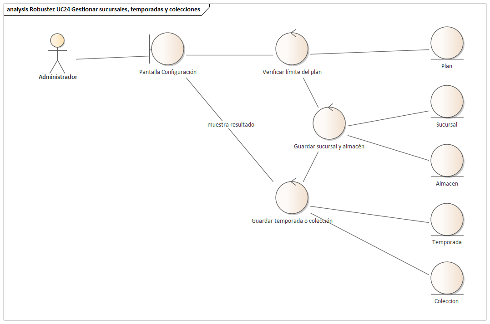

| Control | Entidades o fronteras que usa |
|---|---|
| Verificar límite del plan | Plan |
| Guardar sucursal y almacén | Sucursal y Almacen |
| Guardar temporada o colección | Temporada y Coleccion |

### Robustez UC25 Ajustar inventario y ver el kardex

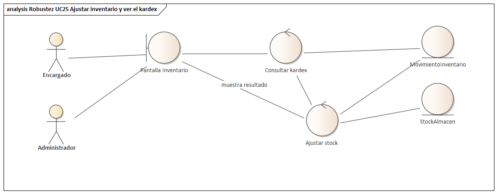

| Control | Entidades o fronteras que usa |
|---|---|
| Consultar kardex | MovimientoInventario |
| Ajustar stock | StockAlmacen y MovimientoInventario |

### Robustez UC26 Moderar opiniones y ver auditoría

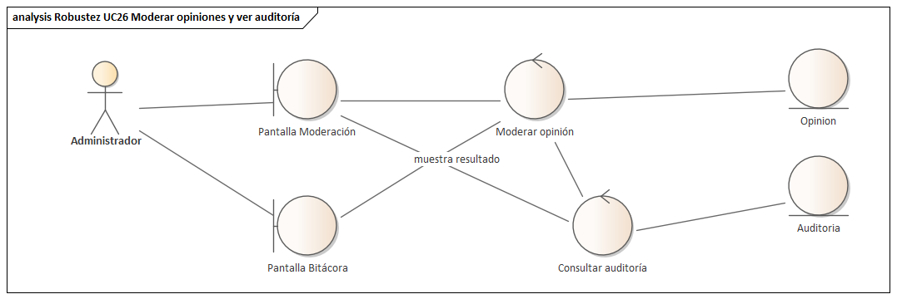

| Control | Entidades o fronteras que usa |
|---|---|
| Moderar opinión | Opinion |
| Consultar auditoría | Auditoria |

### Robustez UC27 Simular un pago

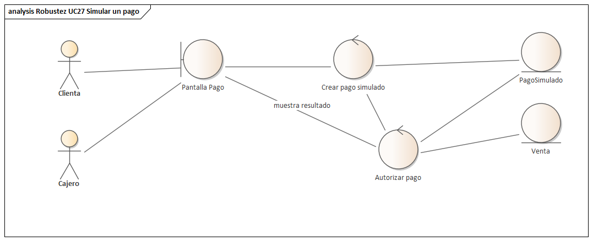

| Control | Entidades o fronteras que usa |
|---|---|
| Crear pago simulado | PagoSimulado |
| Autorizar pago | PagoSimulado y Venta |

### Robustez UC28 Usar el probador 3D

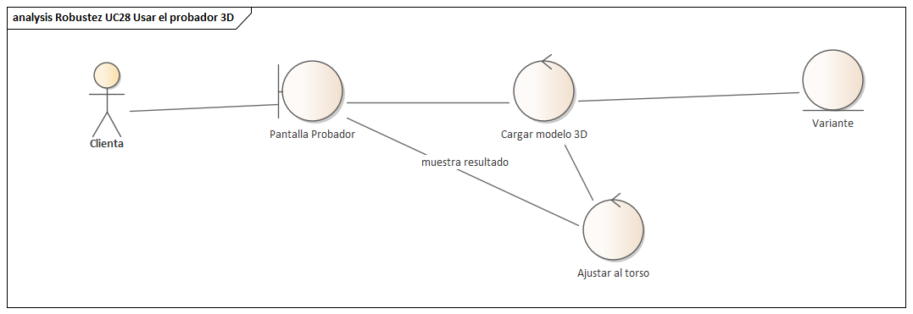

| Control | Entidades o fronteras que usa |
|---|---|
| Cargar modelo 3D | Variante |
| Ajustar al torso | Cálculo interno |

### Robustez UC29 Hablar con el bot

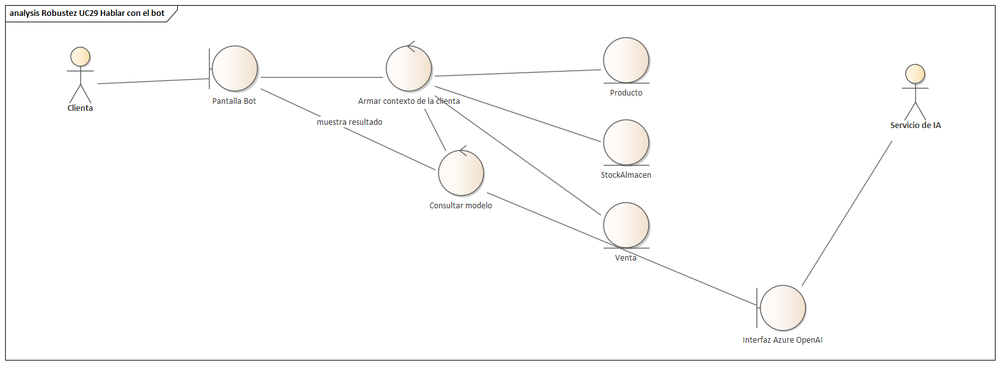

| Control | Entidades o fronteras que usa |
|---|---|
| Armar contexto de la clienta | Producto, StockAlmacen y Venta |
| Consultar modelo | Interfaz Azure OpenAI |

### Robustez UC30 Aplicar precio mayorista

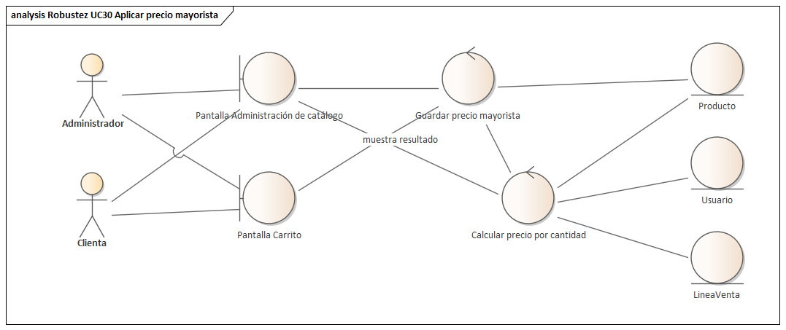

| Control | Entidades o fronteras que usa |
|---|---|
| Guardar precio mayorista | Producto |
| Calcular precio por cantidad | Producto, Usuario y LineaVenta |

### Robustez UC31 Transferir stock entre almacenes

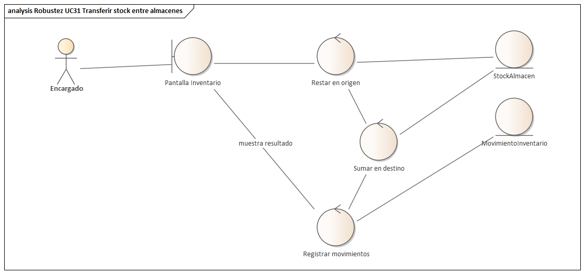

| Control | Entidades o fronteras que usa |
|---|---|
| Restar en origen | StockAlmacen |
| Sumar en destino | StockAlmacen |
| Registrar movimientos | MovimientoInventario |

### Robustez UC32 Despachar un pedido

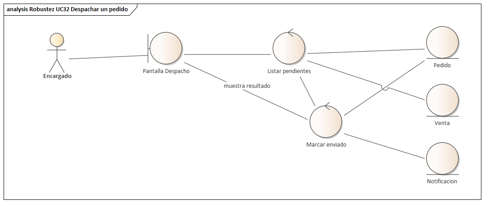

| Control | Entidades o fronteras que usa |
|---|---|
| Listar pendientes | Pedido y Venta |
| Marcar enviado | Pedido y Notificacion |

### Robustez UC33 Devolver una venta

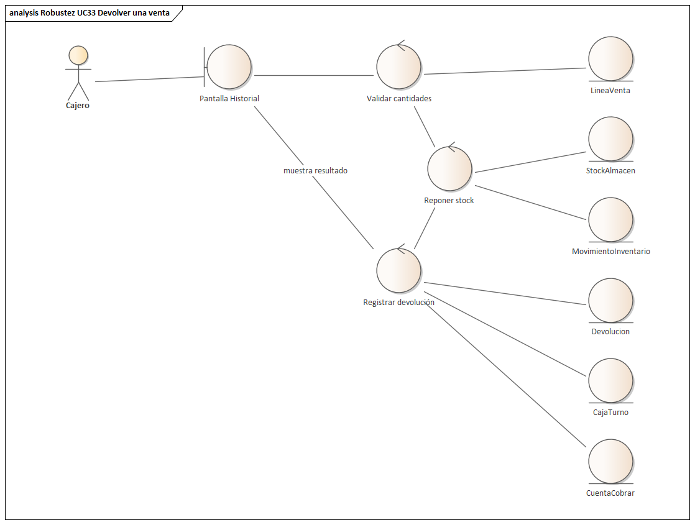

| Control | Entidades o fronteras que usa |
|---|---|
| Validar cantidades | LineaVenta |
| Reponer stock | StockAlmacen y MovimientoInventario |
| Registrar devolución | Devolucion, CajaTurno y CuentaCobrar |

**Hallazgo de la robustez.** Al conectar la devolución con las entidades apareció CuentaCobrar: devolver una venta al crédito debe reducir la deuda y no sacar efectivo de la caja.

### Robustez UC34 Emitir comprobante simulado

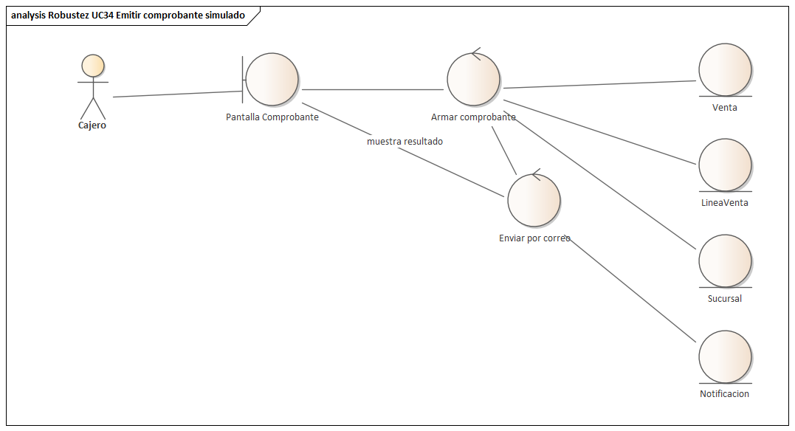

| Control | Entidades o fronteras que usa |
|---|---|
| Armar comprobante | Venta, LineaVenta y Sucursal |
| Enviar por correo | Notificacion |

### Robustez UC35 Instalar la tienda como PWA

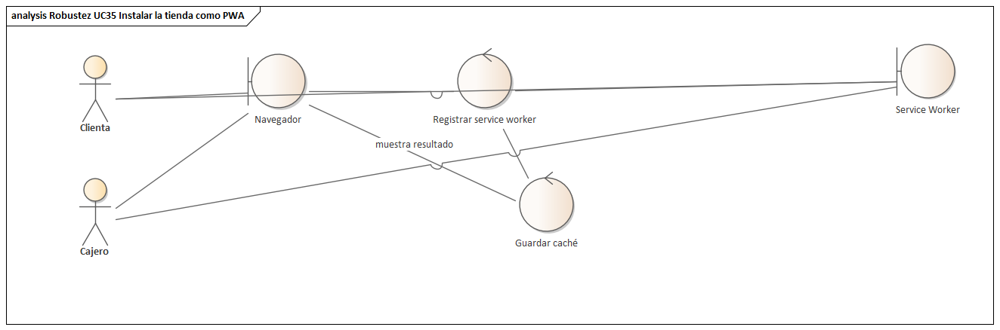

| Control | Entidades o fronteras que usa |
|---|---|
| Registrar service worker | Service Worker |
| Guardar caché | Cálculo interno |

## Lote 1: SaaS multi-tienda

### Robustez UC36 Registrar cuenta en la plataforma

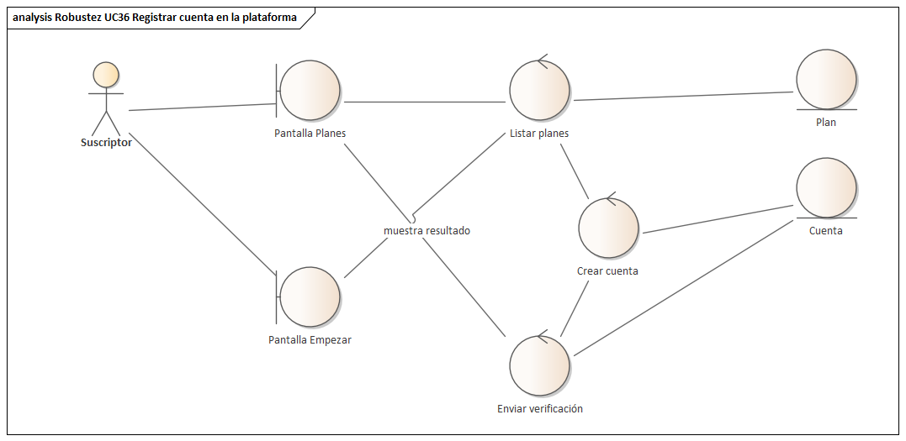

| Control | Entidades o fronteras que usa |
|---|---|
| Listar planes | Plan |
| Crear cuenta | Cuenta |
| Enviar verificación | Cuenta |

### Robustez UC37 Verificar correo

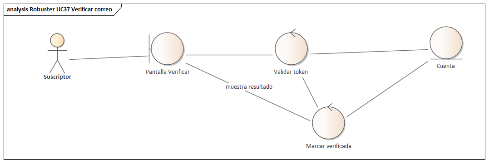

| Control | Entidades o fronteras que usa |
|---|---|
| Validar token | Cuenta |
| Marcar verificada | Cuenta |

### Robustez UC38 Suscribirse y crear tienda

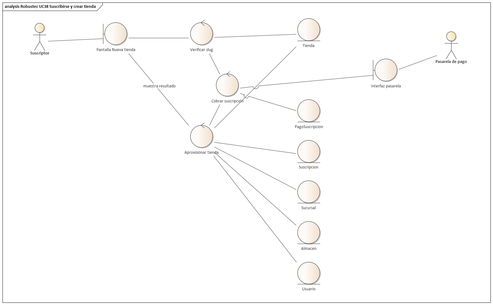

| Control | Entidades o fronteras que usa |
|---|---|
| Verificar slug | Tienda |
| Cobrar suscripción | Interfaz pasarela y PagoSuscripcion |
| Aprovisionar tienda | Tienda, Suscripcion, Sucursal, Almacen y Usuario |

**Hallazgo de la robustez.** El pago y la creación de la tienda debían ser una sola unidad. La robustez separó Cobrar suscripción de Aprovisionar tienda para que el segundo solo ocurra con el pago aprobado.

### Robustez UC39 Renovar o cambiar de plan

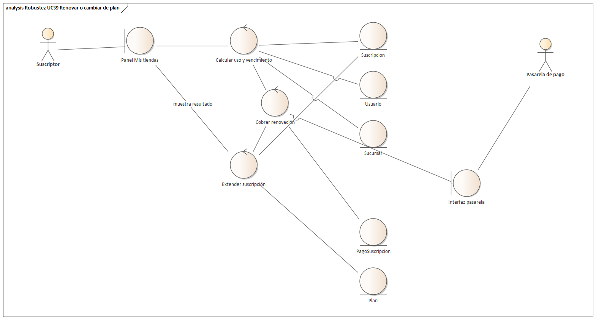

| Control | Entidades o fronteras que usa |
|---|---|
| Calcular uso y vencimiento | Suscripcion, Usuario y Sucursal |
| Cobrar renovación | Interfaz pasarela y PagoSuscripcion |
| Extender suscripción | Suscripcion y Plan |

### Robustez UC40 Cambiar de tienda

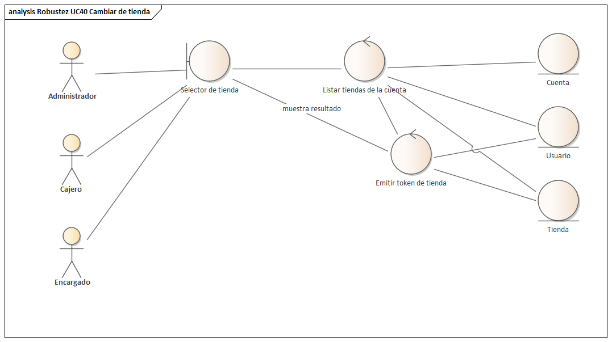

| Control | Entidades o fronteras que usa |
|---|---|
| Listar tiendas de la cuenta | Cuenta, Usuario y Tienda |
| Emitir token de tienda | Usuario y Tienda |

### Robustez UC41 Ver métricas de suscripciones

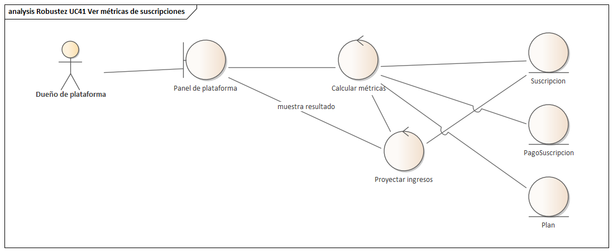

| Control | Entidades o fronteras que usa |
|---|---|
| Calcular métricas | Suscripcion, PagoSuscripcion y Plan |
| Proyectar ingresos | Suscripcion |

## Lote 2: Operación sin conexión y sincronización

### Robustez UC42 Vender sin conexión

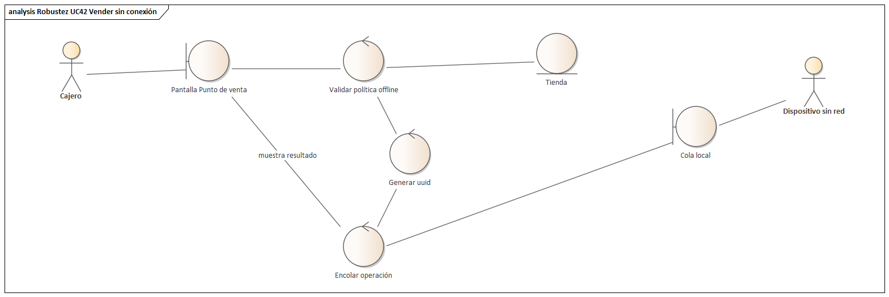

| Control | Entidades o fronteras que usa |
|---|---|
| Validar política offline | Tienda |
| Generar uuid | Cálculo interno |
| Encolar operación | Cola local |

**Hallazgo de la robustez.** La venta sin red no llega al servidor: sus controladores viven en el cliente (los módulos red, cola y caché de la PWA) y la frontera es la Cola local, no la API.

### Robustez UC43 Registrar clienta o producto sin conexión

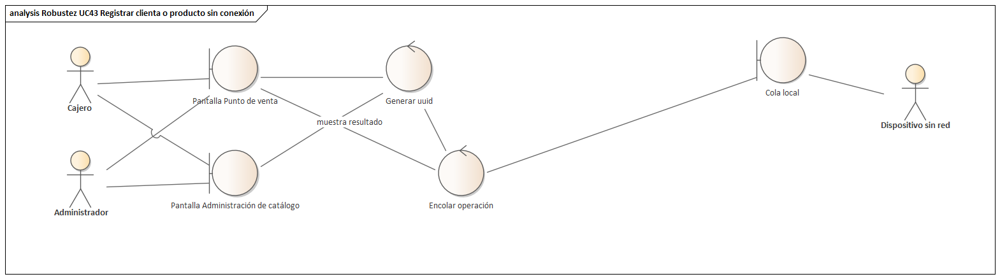

| Control | Entidades o fronteras que usa |
|---|---|
| Generar uuid | Cálculo interno |
| Encolar operación | Cola local |

### Robustez UC44 Sincronizar operaciones pendientes

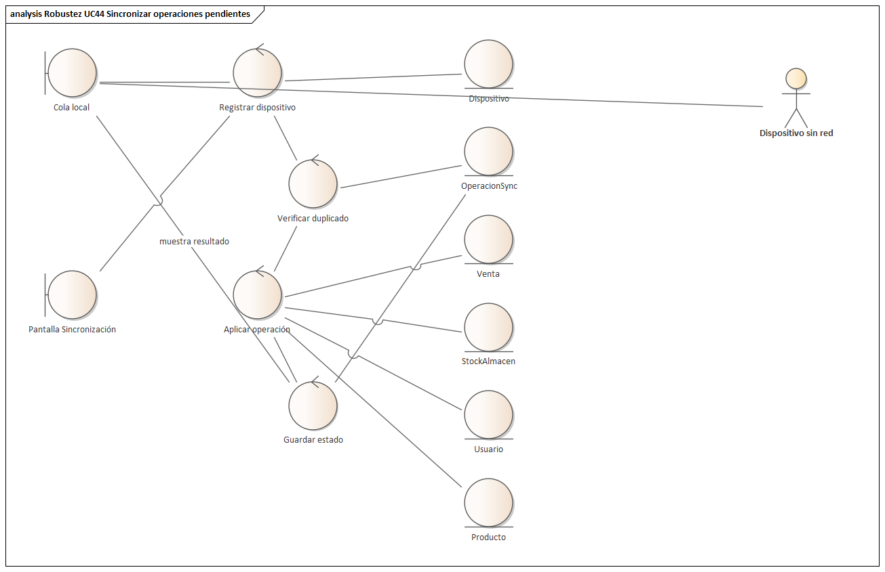

| Control | Entidades o fronteras que usa |
|---|---|
| Registrar dispositivo | Dispositivo |
| Verificar duplicado | OperacionSync |
| Aplicar operación | Venta, StockAlmacen, Usuario y Producto |
| Guardar estado | OperacionSync |

**Hallazgo de la robustez.** El control Verificar duplicado necesitaba una entidad propia para recordar qué uuid ya se aplicó; así nació OperacionSync.

### Robustez UC45 Resolver conflicto de stock

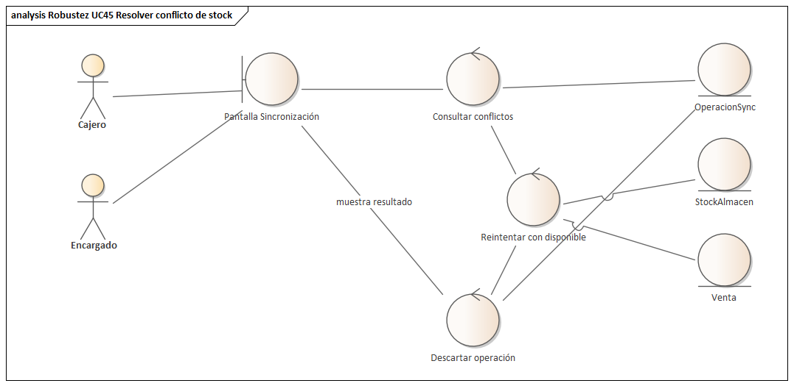

| Control | Entidades o fronteras que usa |
|---|---|
| Consultar conflictos | OperacionSync |
| Reintentar con disponible | StockAlmacen y Venta |
| Descartar operación | OperacionSync |

### Robustez UC46 Configurar ventana offline

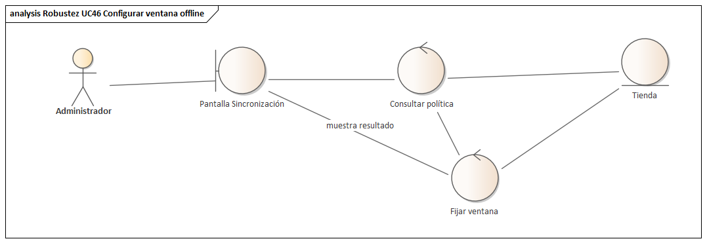

| Control | Entidades o fronteras que usa |
|---|---|
| Consultar política | Tienda |
| Fijar ventana | Tienda |

### Robustez UC47 Activar notificaciones push

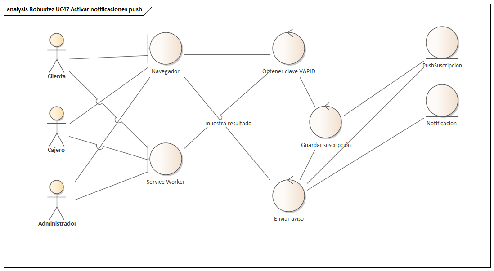

| Control | Entidades o fronteras que usa |
|---|---|
| Obtener clave VAPID | Cálculo interno |
| Guardar suscripción | PushSuscripcion |
| Enviar aviso | PushSuscripcion y Notificacion |

## Lote 3: Reportes generativos y ventas al crédito

### Robustez UC48 Generar reporte por texto o voz

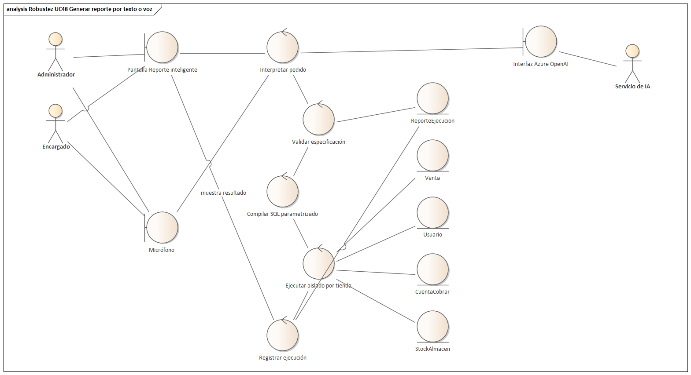

| Control | Entidades o fronteras que usa |
|---|---|
| Interpretar pedido | Interfaz Azure OpenAI |
| Validar especificación | ReporteEjecucion |
| Compilar SQL parametrizado | Cálculo interno |
| Ejecutar aislado por tienda | Venta, Usuario, CuentaCobrar y StockAlmacen |
| Registrar ejecución | ReporteEjecucion |

**Hallazgo de la robustez.** La robustez separó interpretar (IA o reglas), validar y compilar. Solo el compilador produce SQL, y lo hace desde una especificación validada.

### Robustez UC49 Ajustar y exportar reporte

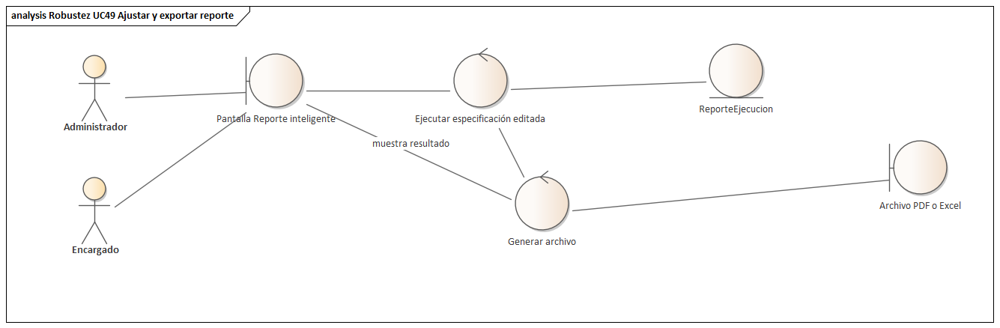

| Control | Entidades o fronteras que usa |
|---|---|
| Ejecutar especificación editada | ReporteEjecucion |
| Generar archivo | Archivo PDF o Excel |

### Robustez UC50 Vender al crédito

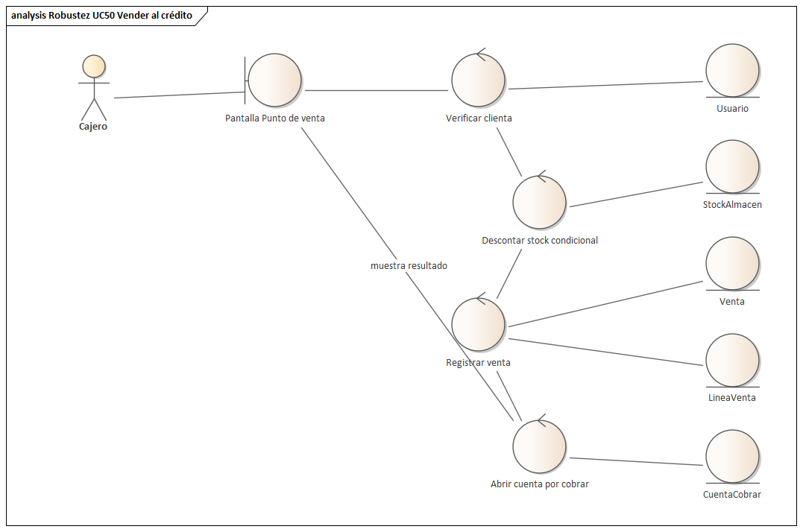

| Control | Entidades o fronteras que usa |
|---|---|
| Verificar clienta | Usuario |
| Descontar stock condicional | StockAlmacen |
| Registrar venta | Venta y LineaVenta |
| Abrir cuenta por cobrar | CuentaCobrar |

### Robustez UC51 Registrar abono de crédito

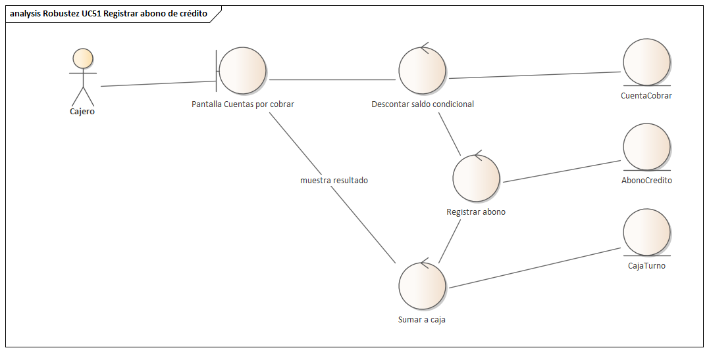

| Control | Entidades o fronteras que usa |
|---|---|
| Descontar saldo condicional | CuentaCobrar |
| Registrar abono | AbonoCredito |
| Sumar a caja | CajaTurno |

**Hallazgo de la robustez.** Descontar el saldo debía ser condicional para que dos abonos simultáneos no lo dejen negativo; el control lleva ese nombre a propósito.

## Lote 4: Analítica con aprendizaje automático

### Robustez UC52 Ver dashboard predictivo

| Control | Entidades o fronteras que usa |
|---|---|
| Obtener predicción | ModeloPredictivo y Venta |
| Calcular métricas | ModeloPredictivo |

### Robustez UC53 Ver segmentación de clientas

| Control | Entidades o fronteras que usa |
|---|---|
| Agrupar clientas | SegmentoCliente, Venta y EventoAnalitica |

## Lote 5: Pagos para países hispanohablantes

### Robustez UC54 Pagar con pasarela internacional

| Control | Entidades o fronteras que usa |
|---|---|
| Crear transacción | TransaccionPasarela y Interfaz pasarela |
| Confirmar pago | TransaccionPasarela y Venta |

## 9.2.1 Revisión de diseño preliminar (PDR)

La PDR aplicó la prueba del resaltador: se recorrió cada frase del curso básico y de los alternos y se marcó el elemento del diagrama que la realiza, hasta que no quedó texto sin objeto ni objeto sin texto.

| Verificación | Resultado |
|---|---|
| Cada caso tiene diagrama de robustez | Sí, 54 diagramas |
| Número de controles por caso dentro de lo recomendado (2 a 5) | Sí; el máximo es 5 (UC48) |
| Ninguna frontera habla con una entidad | Sí; se verificó al generar el modelo |
| Todas las entidades existen en el dominio | Sí; las de los lotes 4 y 5 están marcadas como previstas |
| Los hallazgos se corrigieron en el texto y en el dominio | Sí; ver los hallazgos de cada caso |
| No hay detalle de diseño prematuro (tablas, SQL, frameworks) | Sí; los nombres de tablas y métodos aparecen recién en la secuencia |
